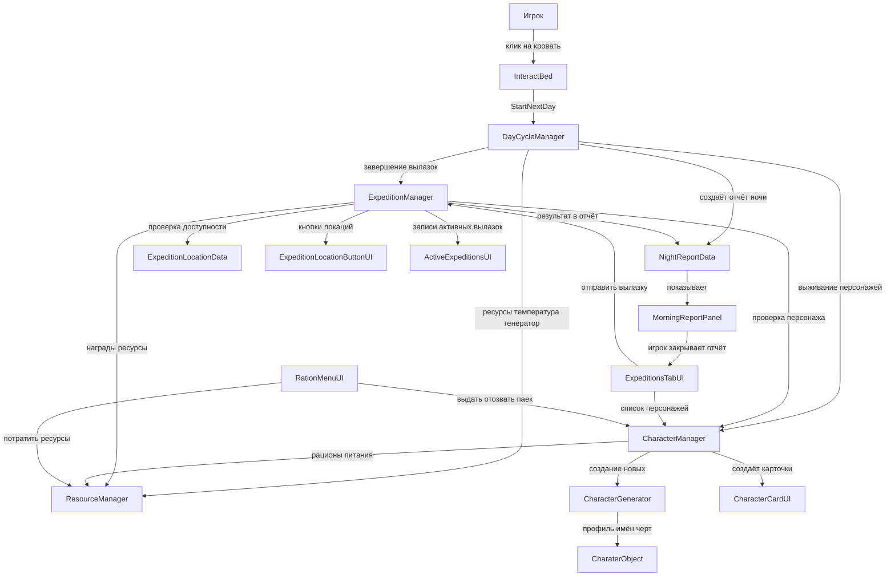

# 🏗️ Архитектурный граф и центральный цикл (начальный уровень)

> Документ описывает **реальную архитектуру кода** проекта «Бункер: Выжившие».  
> Все модули, связи, входы/выходы и точки ветвления сверены с исходниками в `Assets/Scripts`.  
> Диаграммы написаны на Mermaid (`graph TD`) — корректно отображаются в Obsidian.

---

## 1. Архитектурный граф модулей

### Назначение узлов графа

| Узел | Назначение |
|------|------------|
| `InteractBed` | Игрок кликает на кровать → начинается фаза ночи. Блокирует управление, затухает экран, вызывает `DayCycleManager.StartNextDay`. |
| `DayCycleManager` | Центральный диспетчер цикла: считает топливо/температуру, прогоняет выживание, завершает вылазки, проверяет победу/поражение, рассылает `NightReportData`. |
| `ResourceManager` | Хранит еду, воду, топливо, температуру, состояние генератора. Синглтон с событием `OnResourcesChanged`. |
| `CharacterManager` | Список жильцов, выдача/отзыв пайков, создание карточек UI, проверка `isDead`/`isExiled`. |
| `CharacterGenerator` | Создаёт `GeneratedCharacter` на основе профиля `CharaterObject` (имена, черты, портреты, возраст). |
| `ExpeditionManager` | Запуск вылазок, охлаждение локаций, шансы смерти/ранения, выдача наград, завершение по дням. |
| `MorningReportPanel` | Показывает игроку текстовый отчёт ночи: ресурсы, состояния, смерти, уходы, результаты вылазок. |
| `ExpeditionsTabUI` | Выбор локации и персонажа, отправка новой вылазки, отображение доступности. |
| `RationMenuUI` | Раздача еды и воды персонажам на день, просмотр остатков на складе. |
| `NightReportData` | Результат ночи: флаг топлива, температура до/после, списки изменений, смерти, уходы, возвращения вылазок. |
| `GeneratedCharacter` | Персонаж: имя, пол, возраст, здоровье, мораль, дни без еды/воды, флаги рационов, состояние смерти/изгнания, черты. |
| `ResourceData` | Сериализуемое состояние ресурсов: банки еды, бутылки воды, канистры топлива, температура, генератор, текущий день. |
| `ExpeditionLocationData` | ScriptableObject локации: имя, описание, длительность, шансы смерти/ранения, урон, охлаждение, награды. |
| `CharaterObject` | ScriptableObject профиля генерации: пулы имён, черты, портреты, мин./макс. возраст. |

---

## 2. Блок-схема алгоритма центрального цикла

```mermaid
graph TD
    %% Точка входа
    A[Игрок кликает на кровать] --> B[InteractBed.Interact]
    B --> C[Блокировка игрока PlayerMove.enabled = false]
    C --> D[Затухание экрана FadePanel 0 до 1]
    D --> E[DayCycleManager.StartNextDay]

    %% Ресурсы и температура ночи
    E --> F{Генератор включен и не сломан}
    F -->|Да| G[Потратить 1 канистру топлива]
    F -->|Нет| H[Температура minus 1 уровень]
    G --> I[Температура plus 1 уровень макс 3]
    H --> I

    %% Выживание персонажей
    I --> J[Для каждого живого персонажа не в вылазке]

    J --> K{Получал еду сегодня}
    K -->|Да| L[daysWithoutFood = 0, потратить 1 еду]
    K -->|Нет| M[daysWithoutFood plus 1]

    M --> N{daysWithoutFood == 1}
    N -->|Да| O[Сообщение: Голод 1 день без штрафа]
    N -->|Нет| P{daysWithoutFood == 2}
    P -->|Да| Q[Мораль minus 5]
    P -->|Нет| R{daysWithoutFood == 3}
    R -->|Да| S[HP minus 10, Мораль minus 10, Истощен]
    R -->|Нет| T{daysWithoutFood >= 4}
    T -->|Да| U[HP minus 15, Мораль minus 15, Критический голод]
    T -->|Нет| V[К проверке воды]

    U --> W{HP <= 0}
    W -->|Да| X[isDead = true, добавить в deaths]
    W -->|Нет| V

    V --> Y{Получал воду сегодня}
    Y -->|Да| Z[daysWithoutWater = 0, потратить 1 воду]
    Y -->|Нет| AA[daysWithoutWater plus 1]

    AA --> AB{daysWithoutWater == 1}
    AB -->|Да| AC[Мораль minus 5, жажда 1 день]
    AB -->|Нет| AD{daysWithoutWater == 2}
    AD -->|Да| AE[HP minus 5, Мораль minus 10, Обезвоживание]
    AD -->|Нет| AF{daysWithoutWater == 3}
    AF -->|Да| AG[HP minus 15, Мораль minus 15, Сильное обезвоживание]
    AF -->|Нет| AH{daysWithoutWater >= 4}
    AH -->|Да| AI[HP minus 20, Мораль minus 15, Критическое обезвоживание]
    AH -->|Нет| AJ[К проверке температуры]

    AI --> AK{HP <= 0}
    AK -->|Да| X
    AK -->|Нет| AJ

    AJ --> AL{Температура <= 1}
    AL -->|Да| AM[HP minus 15 или minus 30, Мораль minus 10, Мороз]
    AL -->|Нет| AN[К восстановлению]

    AM --> AO{HP <= 0}
    AO -->|Да| X
    AO -->|Нет| AN

    AN --> AP{Восстановление, consecutiveFoodDays >= 2 или consecutiveWaterDays >= 2}
    AP -->|Да| AQ[HP plus 5, Мораль plus 5, макс 100]
    AP -->|Нет| AR[Конец выживания персонажа]

    AQ --> AR
    X --> AR

    %% Экспедиции
    AR --> AS[ExpeditionManager.ProcessCompletedDay]
    AS --> AT{Есть активные вылазки}
    AT -->|Да| AU[Уменьшить daysRemaining на 1]
    AU --> AV{daysRemaining == 0}
    AV -->|Да| AW[CompleteExpedition]
    AV -->|Нет| AX[Следующая вылазка]

    %% Результат вылазки
    AW --> BA{Персонаж мертв}
    BA -->|Да| BB[Вернулся мертвым, наград нет]
    BA -->|Нет| BC{Бросок шанса смерти deathChancePercent}
    BC -->|Удача| BD[Погиб на вылазке]
    BC -->|Неудача| BE{Бросок шанса ранения injuryChancePercent}
    BE -->|Удача| BF[Нанести урон HP, если <= 0 смерть]
    BE -->|Неудача| BG[Выдать награды из possibleRewards]

    BB --> BH[Сообщение в expeditionReturns]
    BD --> BH
    BF --> BH
    BG --> BH
    AX --> BH

    %% Конец ночи
    BH --> BI[RemoveExpiredCooldowns]
    BI --> BJ{Поражение, все мертвы или ушли}
    BJ -->|Да| BK[ПОРАЖЕНИЕ]
    BJ -->|Нет| BL{День >= 10 и есть живые}
    BL -->|Да| BM[ПОБЕДА]
    BL -->|Нет| BN[CurrentDay plus 1, новый день]

    BN --> BO[Сформировать NightReportData]
    BO --> BP[Событие OnNightComplete report]
    BP --> BQ[MorningReportPanel.Show report]

    %% Возврат к дню
    BQ --> BR[Игрок закрывает утренний отчёт]
    BR --> BS[Раздача пайков RationMenuUI]
    BS --> BT[Отправка вылазки ExpeditionsTabUI]
    BT --> A
```

### Пояснение к блок-схеме

- **Прямоугольники** — процессы вычислений и изменений состояния.
- **Ромбы** — точки ветвления (условия if/else).
- **Цепочка A → B → C → … → BT → A** — замыкание центрального цикла: от клика на кровать до возврата к управлению днём и снова к кровати.

---

## 3. Схема данных

```mermaid
graph TD
    %% Персонаж
    GC[GeneratedCharacter]
    GC -->|содержит| TRAITS[List<Trait> traits]
    GC -->|поле| NAME[fullName]
    GC -->|поле| AGE[age]
    GC -->|поле| HEALTH[health]
    GC -->|поле| MORALE[morale]
    GC -->|флаг| ISDEAD[isDead]
    GC -->|флаг| ISEXILED[isExiled]

    %% Ресурсы бункера
    RD[ResourceData]
    RD -->|поле| FOOD[foodCans]
    RD -->|поле| WATER[waterBottles]
    RD -->|поле| FUEL[fuelCans]
    RD -->|поле| TEMP[temperatureLevel]
    RD -->|поле| GENBROKEN[generatorBroken]
    RD -->|поле| GENON[generatorIsOn]
    RD -->|поле| CURDAY[currentDay]

    %% Отчёт ночи
    NRD[NightReportData]
    NRD -->|список| DEATHS[deaths]
    NRD -->|список| DEPARTURES[departures]
    NRD -->|список| EXPEDITIONS[expeditionReturns]
    NRD -->|список| SURVIVAL[survivalChanges]
    NRD -->|список| RESOURCES[resourceChanges]

    %% Вылазка
    ER[ExpeditionRun]
    ER -->|ссылка| ELD[ExpeditionLocationData]
    ER -->|ссылка| GC2[GeneratedCharacter]
    ER -->|поле| DAYS[daysRemaining]

    %% Локация
    ELD -->|список| REWARDS[List<ExpeditionRewardData> possibleRewards]

    %% Профиль генерации
    CO[CharaterObject]
    CO -->|имена| NAMEPOOL[NamePool]
    CO -->|черты| TRAITSLIST[List<Trait> availableTraits]
    CO -->|портреты| MALE[List<Sprite> maleObliks]
    CO -->|портреты| FEMALE[List<Sprite> femaleObliks]

    %% Связи модулей с данными
    CM[CharacterManager] -->|список| GC
    RM[ResourceManager] -->|владеет| RD
    DCM[DayCycleManager] -->|создаёт| NRD
    EM[ExpeditionManager] -->|список| ER
    CG[CharacterGenerator] -->|использует| CO
```

### Описание связей данных

| Источник | Целевой объект | Связь |
|----------|---------------|-------|
| `CharacterManager.characters` | `GeneratedCharacter` | Список всех жильцов бункера |
| `ResourceManager.resourceData` | `ResourceData` | Единственный источник ресурсов |
| `DayCycleManager` → `NightReportData` | Создаёт отчёт каждый вечер | Передаётся в `MorningReportPanel` |
| `ExpeditionManager.activeExpeditions` | `ExpeditionRun` | Активные вылазки с персонажем и локацией |
| `ExpeditionRun.location` | `ExpeditionLocationData` | Данные локации из ScriptableObject |
| `ExpeditionLocationData.possibleRewards` | `ExpeditionRewardData` | Возможные награды за вылазку |
| `CharacterGenerator.profile` | `CharaterObject` | Профиль генерации персонажей |

---

## 4. Описание модулей (начальный уровень)

### 4.1 InteractBed — точка входа в цикл ночи

| Атрибут | Значение |
|---------|----------|
| **Назначение** | Игровой триггер завершения дня. Игрок кликает на кровать, начинается переход к ночи. |
| **Входы** | Нажатие на объект кровати (через `Interactor`), ссылки на `MorningReportPanel`, `DefeatScreenPanel`, `CanvasGroup fadePanel`. |
| **Результаты** | Вызов `DayCycleManager.StartNextDay`, показ `MorningReportPanel` после расчёта, показ `DefeatScreenPanel` при поражении/победе. |
| **Обмен данными** | Получает `NightReportData` через событие `DayCycleManager.OnNightComplete`. Отправляет сигнал `StartNextDay` в `DayCycleManager`. |
| **Ветвления** | Если `_isSleeping == true` — повторный клик игнорируется. После `StartNextDay` проверяются флаги `_defeatOccurred`, `_victoryOccurred`, затем показывается отчёт. |

### 4.2 DayCycleManager — центральный диспетчер цикла

| Атрибут | Значение |
|---------|----------|
| **Назначение** | Управляет ходом дней: считает ресурсы ночи, прогоняет выживание персонажей, завершает вылазки, определяет победу/поражение, рассылает отчёт. |
| **Входы** | Ссылки на `ExpeditionManager`, `CharacterManager`, `ElectricalPanelController`. Данные `ResourceManager.resourceData.currentDay` при загрузке. |
| **Результаты** | `NightReportData` (через `OnNightComplete`), события `OnDefeat`, `OnVictory`, `OnDayChanged`. Изменение `CurrentDay`, `ResourceData.currentDay`. |
| **Обмен данными** | Читает `ResourceManager.Instance` (топливо, температура, генератор), `CharacterManager.characters` (жильцы), `ExpeditionManager` (вылазки). Пишет в `ResourceManager.resourceData.currentDay`. |
| **Ветвления** | Генератор включен и не сломан → тратит топливо, температура плюс 1; иначе температура минус 1. Персонаж получал еду/воду → сброс счётчика, иначе накопление и штрафы. Мораль меньше 0 → изгоняется из бункера. Все мертвы → поражение. День 10 и есть живые → победа. |

### 4.3 ResourceManager — хранилище ресурсов бункера

| Атрибут | Значение |
|---------|----------|
| **Назначение** | Единый источник истины для еды, воды, топлива, температуры и состояния генератора. |
| **Входы** | Вызовы `ConsumeFood/Water/Fuel(amount)`, `AddFood/Water/Fuel(amount)`, `SetTemperature(level)`, `BreakGenerator()`, `RepairGenerator()`, `SetGeneratorOn(bool)`. |
| **Результаты** | Изменение полей `ResourceData`, событие `OnResourcesChanged`. Значения свойств `FoodCans`, `WaterBottles`, `FuelCans`, `TemperatureLevel`, `GeneratorStatus`. |
| **Обмен данными** | Читается и изменяется `DayCycleManager`, `CharacterManager` (трата на рационы), `ExpeditionManager` (награды за вылазки). |
| **Ветвления** | `Consume` возвращает `false`, если ресурса недостаточно или `amount < 0`. Генератор нельзя включить, если сломан. Температура clamping между 0 и 3. |

### 4.4 CharacterManager — управление жильцами

| Атрибут | Значение |
|---------|----------|
| **Назначение** | Список персонажей бункера, выдача/отзыв пайков, создание карточек UI, отслеживание смерти/изгнания. |
| **Входы** | Ссылки на `CharacterGenerator`, `CharacterCardUI` prefab, `bioPanel`. Вызовы `SetFoodRation/SetWaterRation(character, bool)`. |
| **Результаты** | `List<GeneratedCharacter> characters`, событие `OnRationsChanged`, созданные/удалённые карточки UI. |
| **Обмен данными** | Читает `ResourceManager.Instance` при выдаче пайков. Читает `ExpeditionManager` для проверки `IsCharacterOnExpedition`. Пишет в поля `GeneratedCharacter`. |
| **Ветвления** | `CanChangeRation` возвращает `false`, если персонаж мертв, изгнан или не в списке. Если еды/воды недостаточно — выдача отменяется. Персонажи в экспедиции исключаются из раздачи пайков и подсчёта живых. |

### 4.5 CharacterGenerator — создание персонажей

| Атрибут | Значение |
|---------|----------|
| **Назначение** | Генерация новых `GeneratedCharacter` на основе профиля `CharaterObject`. |
| **Входы** | Ссылка на `CharaterObject profile` (имена, черты, портреты, возраст). |
| **Результаты** | Новый экземпляр `GeneratedCharacter` со случайным именем, полом, возрастом, портретом, здоровьем 100, моралью 100, одной случайной чертой. |
| **Обмен данными** | Читает `CharaterObject` (ScriptableObject). Вызывается `CharacterManager.CreateCharacter`. |
| **Ветвления** | Если `profile == null` — возврат `null` с ошибкой. Пол выбирается случайно (50/50). Портреты берутся из списка без повторений (`RemoveAt`). Если портреты закончились — `portrait = null`. |

### 4.6 ExpeditionManager — управление вылазками

| Атрибут | Значение |
|---------|----------|
| **Назначение** | Запуск expeditions, отслеживание охлаждения локаций, расчёт шансов смерти/ранения, выдача наград, завершение по истечении дней. |
| **Входы** | `TryStartExpedition(location, character, out message)`. Ссылки на `CharacterManager`, `ExpeditionLocationData` (через каталог). |
| **Результаты** | `List<ExpeditionRun> activeExpeditions`, событие `OnExpeditionsChanged`, сообщения результатов в `NightReportData.expeditionReturns`. |
| **Обмен данными** | Читает `CharacterManager` (живые персонажи, на вылазке), `ResourceManager` (выдача наград еда/вода/топливо). Изменяет `GeneratedCharacter.isDead`, `GeneratedCharacter.health`. |
| **Ветвления** | Локация недоступна (на вылазке или на охлаждении) → отказ. Персонаж мертв/изгнан/уже на вылазке → отказ. Превышен лимит одновременных вылазок → отказ. При завершении: бросок смерти → персонаж погибает; бросок ранения → урон HP; иначе награды из `possibleRewards`. |

### 4.7 MorningReportPanel — утренняя сводка

| Атрибут | Значение |
|---------|----------|
| **Назначение** | Показывает игроку текстовый отчёт ночи после пробуждения. |
| **Входы** | `NightReportData report`, callback `onContinue` (закрытие панели). Ссылки на `TMP_Text titleText`, `bodyText`, `Button continueButton`. |
| **Результаты** | Отображается панель с отчётом, после клика Continue — скрытие, возврата приоритета камеры, вызов `onContinue`. |
| **Обмен данными** | Получает `NightReportData` от `DayCycleManager` (через `InteractBed`). Читает `CommandantCommentSettings` для комментариев. |
| **Ветвления** | Если есть смерти — комментарий о смерти. Если есть уходы — об уходе. Если голодных >= 2 — про голод. Если жаждущих >= 2 — про жажду. Если раненые — про травму. Иначе — нейтральный комментарий коменданта. |

### 4.8 ExpeditionsTabUI — отправка вылазки

| Атрибут | Значение |
|---------|----------|
| **Назначение** | Интерфейс выбора локации и персонажа для отправки в вылазку. |
| **Входы** | `ExpeditionLocationCatalog`, `CharacterManager`, `ExpeditionManager`, префабы кнопок и карточек. |
| **Результаты** | Создание кнопок локаций, карточек персонажей, вызов `ExpeditionManager.TryStartExpedition`. |
| **Обмен данными** | Читает `ExpeditionManager.IsLocationAvailable`, `IsCharacterOnExpedition`. Пишет в `ExpeditionManager` при отправке. |
| **Ветвления** | Локация на охлаждении или уже в вылазке — кнопка неинтерактивна. Персонаж мертв/изгнан/уже на вылазке — карточка не показывается. Превышен лимит `MaxActiveExpeditions` — отправка заблокирована. |

### 4.9 RationMenuUI — раздача пайков

| Атрибут | Значение |
|---------|----------|
| **Назначение** | Интерфейс выдачи и отзыва еды/воды персонажам на текущий день. |
| **Входы** | `CharacterManager`, `ExpeditionManager`, префаб карточки пайка. |
| **Результаты** | Вызовы `CharacterManager.SetFoodRation/SetWaterRation`, обновление текстов ресурсов. |
| **Обмен данными** | Читает `ResourceManager.Instance` для остатков еды/воды. Подписан на события `OnRationsChanged` и `OnResourcesChanged`. |
| **Ветвления** | Если ресурса недостаточно — выдача отменяется. Если персонаж в экспедиции или мертв/изгнан — карточка не показывается. |

---

## 5. Точки ветвления и граничные случаи

| Место | Условие | Результат |
|-------|---------|-----------|
| `DayCycleManager.StartNextDay` | `ResourceManager == null` | Лог ошибки, выход без расчёта |
| `ResourceManager.Consume*` | `amount < 0` или ресурса недостаточно | `false`, без изменения состояния |
| `ExpeditionManager.TryStartExpedition` | `location == null` / `character == null` | Отказ с сообщением |
| `ExpeditionManager.TryStartExpedition` | `ActiveExpeditionCount >= MaxConcurrentExpeditions` | Отказ с сообщением о лимите |
| `ExpeditionManager.CompleteExpedition` | `character.isDead == true` | Сообщение о смерти, наград нет |
| `ExpeditionManager.CompleteExpedition` | бросок `deathChancePercent` удачен | `MarkCharacterDead`, персонаж умирает |
| `ExpeditionManager.CompleteExpedition` | бросок `injuryChancePercent` удачен | Урон HP, если <= 0 — смерть |
| `DayCycleManager.UpdateSurvivalCounters` | `daysWithoutFood >= 4` | HP minus 15, возможно смерть |
| `DayCycleManager.UpdateSurvivalCounters` | `daysWithoutWater >= 4` | HP minus 20, возможно смерть |
| `DayCycleManager.UpdateSurvivalCounters` | `temperatureLevel <= 1` | Холодный урон HP minus 15/minus 30 |
| `DayCycleManager.ProcessMoraleDepartures` | `morale < 0` и не в экспедиции | `isExiled = true`, уход из бункера |
| `DayCycleManager.IsDefeat` | нет живых и не изгнанных персонажей | `true` → поражение |
| `DayCycleManager.IsVictory` | `CurrentDay >= 10` и не поражение | `true` → победа |

---

## 6. Таймкоды для видео (рекомендуется)

Если записываете видео центрального цикла, привяжите ключевые моменты к шагам выше:

| Таймкод | Событие | Связь со схемой |
|---------|---------|-----------------|
| 0:00–0:15 | Интерфейс бункера, карточки персонажей, ресурсы | `CharacterManager`, `ResourceManager` |
| 0:15–0:30 | Игрок кликает на кровать, затухание экрана | `InteractBed.Interact` |
| 0:30–0:45 | Ночной расчёт: топливо, температура, выживание | `DayCycleManager.StartNextDay` |
| 0:45–1:00 | Завершение вылазки, сообщения о возврате | `ExpeditionManager.ProcessCompletedDay` |
| 1:00–1:15 | Утренняя сводка: смерти, ранения, награды, комендант | `MorningReportPanel.Show` |
| 1:15–1:30 | Игрок закрывает отчёт, начинается новый день | `MorningReportPanel.OnContinueClicked` |
| 1:30–1:45 | Раздача пайков, отправка новой вылазки | `RationMenuUI`, `ExpeditionsTabUI` |
| 1:45–2:00 | Цикл замыкается: игрок снова готов нажать кровать | `InteractBed` |

---

> **Примечание:** этот документ описывает именно **начальный уровень** задания. Жесткие связи модулей (Singletons, `[SerializeField]`, `FindObjectOfType`) и создание объектов во время выполнения (`Instantiate`, `new GeneratedCharacter()`) допускаются и реализованы в коде.
