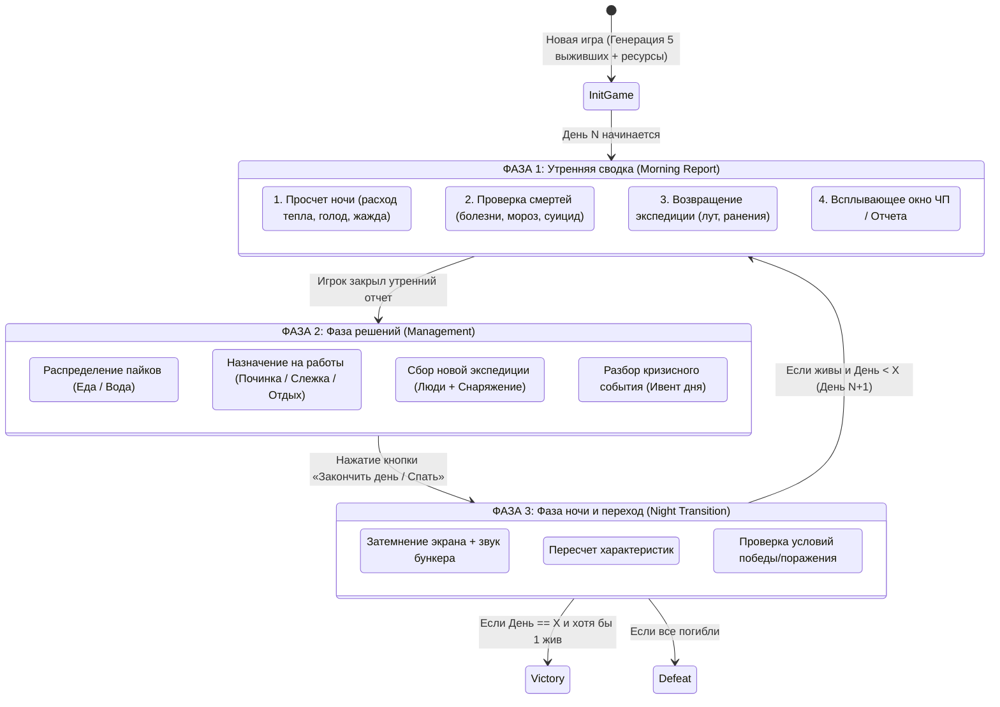

# 🔁 Детальный игровой цикл (Game Loop)

Документ закрывает пробел в оригинальном концепте (где цикл был обозначен лишь общими словами) и дает строгую архитектурную схему для быстрой разработки.

---

## 1. Схема состояний игрового цикла (FSM)

---

## 2. Пошаговая детализация фаз дня

### ФАЗА 1: Утреннее пробуждение и Отчет (Morning Report)
Игрок «просыпается» (звуковой сигнал сирены / зуммера бункера). Экран расцветает из черного. Перед глазами — **Утренняя сводка**.

* **Шаг 1.1. Проверка систем жизнеобеспечения:**
  - Генератор работал ночью? 
    - Да: Температура в норме, мораль стабильна.
    - Нет (сломан): Температура падает на -1 уровень (Тепло -> Холодно -> Обледенение). Все жители получают урон холодом (-15 HP) и штраф к морали (-15).
  - Водопровод работал ночью?
    - Сломан: Воды из крана нет. Выдавать можно только из аварийных канистр.

* **Шаг 1.2. Расчет базового потребления и здоровья:**
  - У каждого жителя снижается `Сытость` и `Жажда`.
  - Если показатель упал до критического уровня: житель получает статус «Истощен» или «Обезвожен», начинает терять здоровье.
  - Если здоровье жителя упало до 0 — фиксируется **Смерть**.

* **Шаг 1.3. Прибытие экспедиции:**
  - Если вчера была отправлена экспедиция:
    - Показывается карточка экспедиции: кто вернулся, сколько принесли еды/воды/деталей.
    - Если произошла травма или гибель — житель помечается раненым/мертвым.
    - Ресурсы зачисляются на склад.

* **Шаг 1.4. Отчет слежки (если назначался шпион):**
  - Под дверью / в папке отчетов лежит записка с утренним компроматом:
    - *«Вчера ночью Доктор тайком пил спирт из аптечки...»* или *«Инженер починил генератор на совесть, он надежен»*.
    - Скрытая черта персонажа становится видимой навсегда!

---

### ФАЗА 2: Фаза управления и распределения (Management Phase)
Основное время геймплея. Игрок свободно переключается между экранами терминала/комнаты.

* **Шаг 2.1. Раздача рационов (Еда и Вода):**
  - Игрок видит 5 карточек персонажей и доступный склад ресурсов.
  - Для каждого человека выбирается рацион на сегодня:
    - **Полный паек** (-2 Еды, -2 Воды): Сытость/Жажда на максимуме, здоровье восстанавливается (+10 HP), мораль растет.
    - **Половинный паек** (-1 Еда, -1 Вода): Поддерживает жизнь, статы не падают, но и не растут.
    - **Без пайка** (0 ресурсов): Голод/Жажда падают в красную зону, -15 HP, мораль падает (-20).

* **Шаг 2.2. Назначение на дневные работы (Одно действие на человека!):**
  Каждый дееспособный житель (HP > 25) может быть назначен ровно на **одну** задачу:
  1. **Ремонт генератора:** устраняет поломку тепла / предотвращает аварию ночью.
  2. **Ремонт водопровода:** чинит подачу воды / фильтры.
  3. **Дежурство / Слежка:** выявляет скрытую черту выбранного жителя или предотвращает кражу ресурсов.
  4. **Отдых в лазарете:** восстанавливает +25 HP и +20 Морали.
  5. **Экспедиция:** подготовка к выходу наружу.

* **Шаг 2.3. Формирование Экспедиции:**
  - Игрок выбирает 1 локацию из доступных на карте (например: «Промзона», «Супермаркет», «Больница»).
  - Назначает 1 или 2 человек.
  - Выдает снаряжение/доп. паек (увеличивает шанс успеха).
  - Нажимает «Отправить». Персонажи покидают бункер до следующего утра.

* **Шаг 2.4. Кризис дня (Дневное событие / Ивент):**
  - Раз в день (или раз в два дня) стучат в дверь или происходит ЧП внутри бункера.
  - Открывается окно диалога с 2-3 взаимоисключающими кнопками решения.
  - *Пример:* «В дверь скребутся. Это беженец с канистрой бензина, но он тяжело кашляет».
    - Вариант А: Впустить (Получить +3 Топлива, но риск заразить колонию).
    - Вариант Б: Прогнать (Никакого риска, но -10 Морали у добрых жителей).
    - Вариант В: Отобрать силой (Нужен сильный персонаж, риск ранения).

---

### ФАЗА 3: Завершение дня и Ночной переход (Night Transition)
* **Шаг 3.1. Игрок нажимает кнопку «Завершить день» (Кровать / Конец смены).**
* **Шаг 3.2. Валидация:**
  - Игра предупреждает, если кто-то остался ненакормлен или генератор критически неисправен.
* **Шаг 3.3. Пересчет ночи:**
  - Снимаются ресурсы за отопление (1 ед. топлива).
  - Считаются вероятности ночных происшествий (если у кого-то мораль < 20 — шанс бунта/побега/суицида).
* **Шаг 3.4. Проверка условий окончания:**
  - **Поражение:** Если число выживших == 0 -> Экран «Бункер замолчал навсегда».
  - **Победа:** Если День == 10 (или 14) и хотя бы 1 человек жив -> Экран «Спасательная экспедиция прибыла! Вы продержались».
  - **Продолжение:** Инкремент `DayCounter++`, переход к Фазе 1 нового дня.

---

## 3. Отличия оригинального цикла v2 от Streamlined-версии

| Параметр | Оригинал v2 | Оптимизированная версия (1.5 недели) |
| :--- | :--- | :--- |
| **Длительность экспедиции** | 1–3 дня случайно | Строго **1 день** (ушли днем -> вернулись утром) |
| **Управление ресурсами** | Микро-дозирование (15, 25, 40 ед. воды) | Дискретные пайки: **Полный / Половинный / Голодовка** |
| **Интерфейс распределения** | Бегать по 3D-комнате к трубам, паллетам, щитку | Единое окно **«Журнал управляющего»** с табами |
| **Число жителей** | 5 со сложными формулами взаимодействия | **4-5 фиксированных архетипов**, понятная синергия |
| **Слежка** | Взятки едой, шансы доверия, генерация 4 текстов | Назначение жителя на слот «Слежка» -> 100% факт утром |
