# 📅 План разработки на 10 дней (Команда из 4 человек)

> **Формат:** 1.5 недели (10–11 рабочих дней).  
> **Состав команды:**
> 1. **Программист 1 (Gameplay / Core):** Архитектура, игровой цикл, менеджер выживших, расчет ночи.
> 2. **Программист 2 (UI / Events):** Интерфейс, карточки, система экспедиций, диалоги ивентов, звук.
> 3. **Художник / UI-дизайнер (2D Art):** Концепт кабинета, портреты, иконки, оформление интерфейса.
> 4. **Геймдизайнер / Нарратив / QA:** Баланс, тексты ивентов, сборка данных (SO/JSON), звуки, тестирование.

---

## 🧭 График по спринтам

```mermaid
gantt
    title График разработки «Холодный Ковчег» (10 дней)
    dateFormat  X
    axisFormat День %d
    
    section Спринт 1: Ядро
    Архитектура и FSM дня      :active, p1, 1, 3
    Базовый UI и связка кнопок  :active, p2, 1, 3
    Скетчи UI и 6 портретов     :active, p3, 1, 3
    ТЗ, баланс-таблица, тексты  :active, p4, 1, 3
    
    section Спринт 2: Фичи
    Экспедиции и расчет ночи   :p1_2, 4, 7
    Окна ивентов и отчетов     :p2_2, 4, 7
    Финальный арт кабинета и UI:p3_2, 4, 7
    Внедрение ивентов и звуков :p4_2, 4, 7
    
    section Спринт 3: Релиз
    Багфикс и полировка кода   :crit, p1_3, 8, 10
    Интеграция соков и анимаций:crit, p2_3, 8, 10
    Экран победы/поражения     :p3_3, 8, 9
    Плейтесты, баланс, билд    :crit, p4_3, 8, 10
```

---

## 📆 Подробный подневный план (День 1 — День 10)

### СПРИНТ 1: Играбельный серый прототип (Дни 1–3)
**Цель спринта:** К вечеру Дня 3 игра должна запускаться, менять дни от 1 до 10, списывать еду/воду и выводить заглушечный экран победы/поражения.

#### День 1: Старт, архитектура и ТЗ
- **Программист 1:** Настройка репозитория (Git/LFS). Создание базовых классов `Survivor`, `ResourceManager`, скелет `DayCycleManager` (FSM: Morning -> Day -> Night).
- **Программист 2:** Прототипирование Canvas: расположение главного экрана (стол/терминал), тестовые кнопки смены дня и распределения пайков.
- **Художник:** Поиск референсов (стиль: дизельпанк / советский бункер / ретрофутуризм). Черновой набросок главного экрана и палитры цветов.
- **Геймдизайнер:** Финализация формул в Excel/Google Sheets. Список 6 персонажей с точными числовыми параметрами.

#### День 2: Базовые механики выживания
- **Программист 1:** Логика потребления ресурсов за ночь (еда, вода, топливо). Обработка состояний (Сыт -> Голоден -> Урон HP).
- **Программист 2:** Создание префаба карточки персонажа (Имя, Портрет-заглушка, ползунки HP/Мораль, кнопки выбора пайка).
- **Художник:** Отрисовка 6 финальных портретов персонажей (в едином стиле, на нейтральном фоне).
- **Геймдизайнер:** Написание текстов для 10 базовых происшествий и утренних сводок. Поиск звуков окружения (гул генератора, метель).

#### День 3: Первый игровой цикл (Milestone 1: Greybox)
- **Программист 1:** Проверка условий Победы (10 дней) и Поражения (все мертвы). Интеграция поломки генератора.
- **Программист 2:** Связка карточек персонажей с данными `DayCycleManager`. Кнопка «Лечь спать» с переходом на следующий день.
- **Художник:** Отрисовка набора иконок: Еда 🥫, Вода 💧, Детали ⚙️, Тепло 🌡️, Здоровье ❤️, Мораль 🧠.
- **Геймдизайнер:** Первый прогон серого билда. Проверка: хватает ли ресурсов при разных стратегиях раздачи пайков.

---

### СПРИНТ 2: Контент, Экспедиции и Атмосфера (Дни 4–7)
**Цель спринта:** Подключение всех игровых систем: полноценные экспедиции, случайные ивенты, вскрытие тайн, финальный визуальный стиль.

#### День 4: Система экспедиций
- **Программист 1:** Математика экспедиций (расчет шанса ранения, гибели и лута с учетом навыков участников: Ветеран, Следопыт).
- **Программист 2:** Экран карты экспедиций: выбор из 3 локаций, назначение 1-2 участников, кнопка «Отправить».
- **Художник:** Финальный арт главного экрана (Кабинет коменданта / Терминал со следами инея на стекле).
- **Геймдизайнер:** Заполнение таблицы лута и рисков для 3 локаций. Написание 6 текстов отчетов разведки.

#### День 5: Система случайных ивентов и дилемм
- **Программист 1:** Менеджер ивентов (`EventManager`). Механизм триггеров: по дню, по уровню морали, случайные.
- **Программист 2:** Модальное окно диалога/дилеммы: Заголовок, Художественный текст, 2-3 кнопки выбора с проверкой условий (напр. «Нужен Механик»).
- **Художник:** Отрисовка карты вылазок (стилизованная тактическая схема с 3 зонами) + рамки окон диалогов.
- **Геймдизайнер:** Написание 15 вариативных ивентов с последствиями для ресурсов и людей. Подбор SFX (стук в дверь, щелчки тумблеров, тревога).

#### День 6: Слежка, тайны и изгнание
- **Программист 1:** Механика роли «Дежурный/Слежка»: вскрытие скрытого трейта ночью. Механика «Выгнать из бункера» (-мораль группе).
- **Программист 2:** Окно досье персонажа: отображение вскрытой тайны, кнопка изгнания с подтверждением.
- **Художник:** Арт для экранов концовки: 1) «Победа: Эвакуация», 2) «Поражение: Замерзший бункер».
- **Геймдизайнер:** Интеграция текстов тайн и утренних доносов в ScriptableObjects.

#### День 7: Сборка вертикального среза (Milestone 2: Alpha)
- **Вся команда:** Сборка Альфа-билда.
- **Программисты 1 и 2:** Мердж веток, устранение конфликтов логики и UI.
- **Художник:** Внедрение всех спрайтов в проект, настройка шрифтов и UI-якорей (Anchors) под разрешение 1920x1080.
- **Геймдизайнер:** Проведение 5 полных игровых сессий. Фиксация баланса: игра не должна проходиться «всухую» без потерь.

---

### СПРИНТ 3: Полировка, Баланс и Релиз (Дни 8–10)
**Цель спринта:** Никаких новых механик! Только исправление багов, улучшение отклика интерфейса (Game Feel), балансировка и подготовка билда к сдаче.

#### День 8: Звук и сочность интерфейса (Juice & Game Feel)
- **Программист 1:** Исправление багов краевых случаев (что если в экспедицию отправили при 1 HP? что если кончилась и еда, и вода одновременно?).
- **Программист 2:** Интеграция `AudioManager`: фоновая метель, музыкальное напряжение, звуки кнопок, плавный Fade to Black при смене дня.
- **Художник:** Мелкие визуальные эффекты: виньетка замерзания при падении температуры, тряска экрана при аварии генератора.
- **Геймдизайнер:** Тонкая настройка вероятностей: кривая сложности должна нарастать к 6–8 дням.

#### День 9: Финальное тестирование и заморозка фичей (Feature Freeze)
- **Программисты:** Устранение критических и визуальных багов из QA-таблицы. Оптимизация сборки.
- **Художник:** Оформление обложки (титульный арт), иконки игры и логотипа для презентации.
- **Геймдизайнер:** Проверка всех текстов на опечатки, подготовка сценария демонстрации / питча проекта для жюри.

#### День 10: Финальный релизный билд и сдача (Gold Master)
- **Программист 1:** Сборка Standalone Windows Build + WebGL (если требуется для браузера).
- **Вся команда:** Проверка чистого билда на стороннем ПК.
- **Геймдизайнер:** Подготовка документации, видео геймплея и презентации проекта. Защита проекта!
