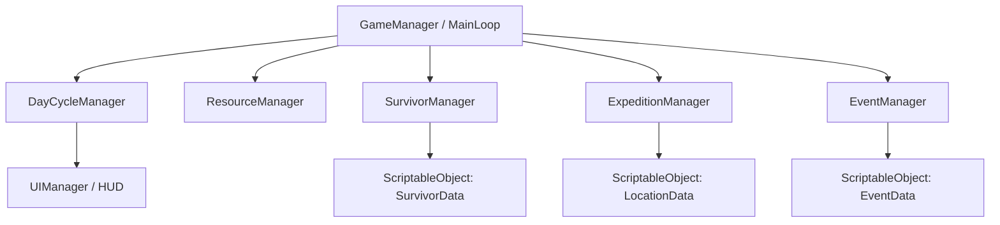

# 💻 Техническая архитектура и структуры данных (Unity / C#)

> Документ подготовлен специально для двух программистов команды. Позволяет не тратить время на споры об архитектуре и сразу начать писать код с 1-го дня.

---

## 1. Общая схема архитектуры

Архитектура строится по принципу **Data-Driven Design** на ScriptableObject'ах для контента и централизованных менеджерах.



---

## 2. Базовые структуры данных (C#)

### 2.1. Данные выжившего (`SurvivorInstance.cs`)
```csharp
using System;
using UnityEngine;

public enum ProfessionType { Mechanic, Doctor, Veteran, Cook, Diplomat, Scout }
public enum SecretTraitType { Kleptomaniac, Morphinist, PtsdAggressor, Paranoid, Saboteur, Asthmatic }
public enum JobType { None, RepairGenerator, RepairPipes, Watchman, Infirmary, Expedition }
public enum HungerStatus { WellFed, Hungry, Starving }

[System.Serializable]
public class SurvivorInstance
{
    public string survivorName;
    public Sprite portrait;
    public ProfessionType profession;
    public SecretTraitType secretTrait;
    public bool isSecretRevealed = false;
    
    [Range(0, 100)] public int health = 100;
    [Range(0, 100)] public int morale = 80;
    public HungerStatus hunger = HungerStatus.WellFed;
    public bool isThirsty = false;
    public bool isAlive = true;
    
    public JobType assignedJob = JobType.None;
    public int dailyRationLevel = 1; // 0 = Голодовка, 1 = Норма, 2 = Двойной

    public void ApplyDamage(int amount)
    {
        health = Mathf.Clamp(health - amount, 0, 100);
        if (health <= 0) isAlive = false;
    }

    public void ModifyMorale(int delta)
    {
        morale = Mathf.Clamp(morale + delta, 0, 100);
    }
}
```

---

### 2.2. Менеджер ресурсов (`ResourceManager.cs`)
```csharp
using UnityEngine;
using System;

public class ResourceManager : MonoBehaviour
{
    public static ResourceManager Instance { get; private set; }

    [Header("Складские запасы")]
    public int food = 10;
    public int water = 10;
    public int fuel = 5;

    [Header("Состояние бункера")]
    public int temperatureLevel = 3; // 3 = Тепло, 2 = Прохладно, 1 = Холод, 0 = Обледенение
    public bool isGeneratorBroken = false;
    public bool isPipesBroken = false;

    public event Action OnResourcesChanged;

    private void Awake() => Instance = this;

    public bool HasFood(int amount) => food >= amount;
    public bool HasWater(int amount) => water >= amount;
    public bool HasFuel(int amount) => fuel >= amount;

    public void Consume(int f, int w, int fl)
    {
        food = Mathf.Max(0, food - f);
        water = Mathf.Max(0, water - w);
        fuel = Mathf.Max(0, fuel - fl);
        OnResourcesChanged?.Invoke();
    }

    public void AddResources(int f, int w, int fl)
    {
        food += f;
        water += w;
        fuel += fl;
        OnResourcesChanged?.Invoke();
    }
}
```

---

### 2.3. Контроллер цикла дня (`DayCycleManager.cs`)
```csharp
using UnityEngine;
using System.Collections.Generic;

public enum DayPhase { MorningReport, DayManagement, NightProcessing, Victory, Defeat }

public class DayCycleManager : MonoBehaviour
{
    public static DayCycleManager Instance { get; private set; }

    public int currentDay = 1;
    public const int MAX_DAYS = 10;
    public DayPhase currentPhase = DayPhase.DayManagement;

    [SerializeField] private List<SurvivorInstance> survivors = new List<SurvivorInstance>();

    private void Awake() => Instance = this;

    // Вызывается по клику на кнопку «Лечь спать»
    public void FinishDay()
    {
        currentPhase = DayPhase.NightProcessing;
        ProcessNight();
    }

    private void ProcessNight()
    {
        // 1. Расход топлива на обогрев
        if (!ResourceManager.Instance.isGeneratorBroken && ResourceManager.Instance.fuel > 0)
        {
            ResourceManager.Instance.fuel--;
            if (ResourceManager.Instance.temperatureLevel < 3) 
                ResourceManager.Instance.temperatureLevel++;
        }
        else
        {
            ResourceManager.Instance.temperatureLevel = Mathf.Max(0, ResourceManager.Instance.temperatureLevel - 1);
        }

        // 2. Расчет состояния каждого выжившего
        int aliveCount = 0;
        foreach (var s in survivors)
        {
            if (!s.isAlive) continue;

            // Обработка холода
            if (ResourceManager.Instance.temperatureLevel <= 1)
            {
                s.ApplyDamage(15);
                s.ModifyMorale(-10);
            }

            // Обработка еды
            if (s.dailyRationLevel == 0)
            {
                s.hunger = (s.hunger == HungerStatus.WellFed) ? HungerStatus.Hungry : HungerStatus.Starving;
                if (s.hunger == HungerStatus.Starving) s.ApplyDamage(20);
                s.ModifyMorale(-15);
            }
            else
            {
                s.hunger = HungerStatus.WellFed;
                if (s.dailyRationLevel == 2) s.health = Mathf.Min(100, s.health + 10);
            }

            if (s.isAlive) aliveCount++;
        }

        // 3. Проверка конца игры
        if (aliveCount == 0)
        {
            currentPhase = DayPhase.Defeat;
            UIManager.Instance.ShowGameOverScreen(false);
            return;
        }

        if (currentDay >= MAX_DAYS)
        {
            currentPhase = DayPhase.Victory;
            UIManager.Instance.ShowGameOverScreen(true);
            return;
        }

        // 4. Переход к новому дню
        currentDay++;
        currentPhase = DayPhase.MorningReport;
        ExpeditionManager.Instance.ResolvePendingExpedition();
        UIManager.Instance.ShowMorningReport();
    }
}
```

---

### 2.4. Система ивентов на ScriptableObject (`EventData.cs`)
```csharp
using UnityEngine;
using System.Collections.Generic;

[CreateAssetMenu(fileName = "NewEvent", menuName = "Shelter/Event")]
public class EventData : ScriptableObject
{
    public string eventID;
    public string title;
    [TextArea(3, 6)] public string description;
    public Sprite eventIllustration;

    public List<EventChoice> choices;
}

[System.Serializable]
public class EventChoice
{
    public string choiceText;
    [TextArea(2, 4)] public string outcomeText;
    
    // Эффекты
    public int foodDelta;
    public int waterDelta;
    public int fuelDelta;
    public int moraleDeltaAll;
    public int healthDeltaRandom;
    public ProfessionType requiredProfession = ProfessionType.None; // Доступно только при живом специалисте
}
```

---

### 2.5. Скрипт взаимодействия с 3D-точками интереса (`InteractablePOI.cs`)

Этот скрипт вешается на каждую из 8 3D-моделей в комнате (Трубы, Кровать, Щиток, ПК, Доска и т.д.).
Он управляет включением обводки ([[Обводка|Outline]]) и открытием соответствующего 2D-окна на Canvas.

```csharp
using UnityEngine;
using UnityEngine.Events;

public enum POIType 
{ 
    Bed,               // 1. Кровать -> переход дня
    PC_Terminal,       // 2. Терминал -> вылазки и изгнание
    InvestigationBoard,// 3. Доска расследования -> досье и слежка
    WaterPipes,        // 4. Трубы водопровода -> поение и ремонт
    ElectricPanel,     // 5. Электрощиток -> тепло и генератор
    FoodPallets,       // 6. Паллеты с едой -> выдача пайков
    HeavyDoor,         // 7. Гермодверь -> ивенты и конверт
    SettingsPainting   // 8. Картина с шестеренкой -> меню настроек
}

public class InteractablePOI : MonoBehaviour
{
    [Header("Настройки точки интереса")]
    public POIType poiType;
    public string promptText = "[E] Взаимодействовать";
    
    [Header("Событие открытия окна")]
    public GameObject targetUIPanel; // Соответствующая панель на Canvas
    
    [Header("Визуальный отклик")]
    [SerializeField] private Outline outlineComponent; // Компонент обводки
    
    private void Awake()
    {
        if (outlineComponent == null) outlineComponent = GetComponent<Outline>();
        if (outlineComponent != null) outlineComponent.enabled = false;
    }

    public void OnHoverEnter()
    {
        if (outlineComponent != null) outlineComponent.enabled = true;
        HUDController.Instance.ShowPrompt(promptText);
    }

    public void OnHoverExit()
    {
        if (outlineComponent != null) outlineComponent.enabled = false;
        HUDController.Instance.HidePrompt();
    }

    public void Interact()
    {
        // Специальная логика для кровати (сон)
        if (poiType == POIType.Bed)
        {
            DayCycleManager.Instance.FinishDay();
            return;
        }

        // Для остальных 7 точек открываем соответствующий 2D UI
        if (targetUIPanel != null)
        {
            UIManager.Instance.OpenPanel(targetUIPanel);
        }
    }
}
```

---

### 2.6. Контроллер луча игрока (`PlayerRaycaster.cs`)

Вешается на главную камеру игрока. Пускает луч из центра экрана:

```csharp
using UnityEngine;

public class PlayerRaycaster : MonoBehaviour
{
    [SerializeField] private float interactDistance = 3.5f;
    [SerializeField] private LayerMask interactableLayer;
    
    private InteractablePOI currentTarget;

    void Update()
    {
        // Если уже открыто 2D окно - блокируем луч
        if (UIManager.Instance.IsAnyPanelOpen) 
        {
            if (Input.GetKeyDown(KeyCode.Escape) || Input.GetMouseButtonDown(1))
            {
                UIManager.Instance.CloseAllPanels();
            }
            return;
        }

        Ray ray = new Ray(transform.position, transform.forward);
        if (Physics.Raycast(ray, out RaycastHit hit, interactDistance, interactableLayer))
        {
            InteractablePOI poi = hit.collider.GetComponent<InteractablePOI>();
            if (poi != null)
            {
                if (currentTarget != poi)
                {
                    if (currentTarget != null) currentTarget.OnHoverExit();
                    currentTarget = poi;
                    currentTarget.OnHoverEnter();
                }

                if (Input.GetKeyDown(KeyCode.E) || Input.GetMouseButtonDown(0))
                {
                    currentTarget.Interact();
                }
                return;
            }
        }

        if (currentTarget != null)
        {
            currentTarget.OnHoverExit();
            currentTarget = null;
        }
    }
}
```

---

## 3. Рекомендации по оптимизации разработки (Советы программистам)

1. **Один рабочий Canvas со вкладками (Tabs):**
   - Не делайте загрузку разных сцен для комнат или досье! Держите все экраны на одном Canvas: `MorningPanel`, `DeskPanel`, `ExpeditionPanel`, `EventPanel`. Переключение через `SetActive(true/false)`.
2. **Все числовые значения — в Inspector / ScriptableObjects:**
   - Никаких захардкоженных формул в коде. Геймдизайнер должен сам крутить баланс прямо в Unity без пересборки скриптов.
3. **Модель событий (Actions/Events):**
   - UI слушает события изменения ресурсов (`OnResourcesChanged`), а не опрашивает их в `Update()`. Это спасет от десятков багов рассинхронизации интерфейса.
