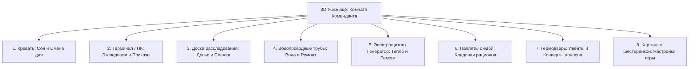

# 🎯 Руководство по 8 точкам взаимодействия (3D Room POIs)

> **Контекст:** 3D-модели комнаты и предметов уже готовы! В этом документе расписано устройство каждой из **8 точек интереса (POI)**: логика камеры, триггеры обводки (Outline), открывающиеся 2D-интерфейсы, звуки и действия.

---

## 🕹️ Общий принцип управления в 3D комнате

Чтобы избежать багов физики и ускорить разработку:
- **Управление:** Вид от 1-го лица (WASD — ходьба, мышь — обзор, `E` или `ЛКМ` — взаимодействие, `ESC` или `ПКМ` — выход из окна обратно в 3D).
- **Наведение на объект:**
  - При наведении курсора на интерактивный объект срабатывает шейдер обводки ([[Обводка|Outline Highlight]]).
  - Появляется подсказка внизу экрана: `[E] Осмотреть трубы`, `[E] Сесть за ПК`, `[E] Лечь спать`.
- **Взаимодействие:** Камера плавно подъезжает (Lerp / Cinemachine) к объекту, включается курсор мыши, поверх 3D рендерится стилизованное 2D-окно интерфейса.

---

## 🧭 Карта 8 точек интереса (Интерактивные объекты)

---

## 1. 🛏️ Кровать (Bed) — Завершение дня и переход

* **Визуальное состояние:** Старая армейская койка с одеялом.
* **При наведении:** `[E] Лечь спать / Завершить день`.
* **Логика работы:**
  1. При нажатии проверяется: все ли критические действия выполнены?
     - Если кто-то остался без воды/еды или генератор горит — выводится модальное предупреждение: *«Внимание: запасы воды не распределены. Все равно уснуть?»*
  2. Затемнение экрана (Fade to Black, 1.2 сек) + звук тяжелого выдоха и затухания света.
  3. В темноте играет ночной эмбиент (ветер снаружи, капли воды, треск генератора).
  4. Срабатывает скрипт ночного пересчета (`NightProcessor`).
  5. Экран плавно светлеет: игрок «просыпается», перед глазами сразу открывается **Утренняя сводка** (кто заболел, что сломалось, что принесла экспедиция).

---

## 2. 💻 ПК / Терминал (PC) — Экспедиции и Решения

* **Визуальное состояние:** ЭЛТ-монитор с зеленым свечением и клавиатура.
* **При наведении:** `[E] Открыть терминал управления`.
* **Интерфейс 2D окна (2 вкладки):**
  - **Вкладка 1: «ВЫЛАЗКИ (Экспедиции)»**
    - Тактическая карта с 3 точками: 1) Супермаркет, 2) Аптека, 3) ТЭЦ.
    - Выбор 1–2 жильцов в группу кликом по их мини-портретам.
    - Кнопка `[ОТПРАВИТЬ ГРУППУ]`. После нажатия персонажи помечаются статусом «На вылазке» до следующего утра.
  - **Вкладка 2: «ПРИКАЗЫ И СУД»**
    - Список жильцов с кнопкой `[ВЫГНАТЬ ИЗ БУНКЕРА]`.
    - При нажатии — окно подтверждения: *«Выгнать Кузьмича на мороз? Он покинет бункер навсегда. Мораль остальных упадет на -20»*.

---

## 3. 📌 Доска расследования (Investigation Board) — Досье и Слежка

* **Визуальное состояние:** Пробковая доска на стене, на ней приколоты булавками фотографии 5 выживших, соединенные красными нитями.
* **При наведении:** `[E] Изучить досье выживших`.
* **Интерфейс 2D окна:**
  - 5 карточек персонажей с портретами, именем, профессией и шкалами (HP, Мораль, Статус питания).
  - Слот **«ТАЙНА»**: изначально закрыт черной плашкой с вопросительным знаком.
  - Кнопка **«УСТАНОВИТЬ СЛЕЖКУ»** (доступна 1 раз в день):
    - Выбираем человека-шпиона (например, Механика) и цель слежки (например, Доктора).
    - Ночью шпион присматривает за целью. Утром у двери появится конверт с уликой, которая навсегда раскроет тайну!

---

## 4. 🚰 Водопроводные трубы (Water Pipes) — Раздача воды и Ремонт

* **Визуальное состояние:** Ржавые трубы с манометром и вентилями. Если сломаны — из стыка с шипением бьет струя воды/пара.
* **При наведении:** `[E] Проверить водопровод`.
* **Интерфейс 2D окна:**
  - **Счетчик ресурса:** «Запас воды: X канистр».
  - **Если водопровод РАБОТАЕТ:**
    - Список жильцов. Напротив каждого кнопка `[Выдать воду (1 канистра)]`.
    - Индикатор: «Утолил жажду» (зеленый) / «Хочет пить» (красный).
  - **Если водопровод СЛОМАН (Авария):**
    - Экран блокируется красной надписью: *«АВАРИЯ: Засор фильтров! Подача воды невозможна!»*
    - Кнопка: `[Назначить человека на починку]`.
    - Можно выбрать любого здорового жильца (если выбрать Сантехника — ремонт мгновенный и гарантированный).

---

## 5. ⚡ Электрощиток / Генератор (Electrical Panel) — Тепло и Энергия

* **Визуальное состояние:** Металлический шкаф с рубильником, лампочками и проводами. Если сломан — летят искры и мигает аварийный красный свет в комнате.
* **При наведении:** `[E] Осмотреть генератор`.
* **Интерфейс 2D окна:**
  - **Индикатор тепла в бункере:** Шкала 4 уровней: `Обледенение` ➔ `Холодно` ➔ `Прохладно` ➔ `Тепло`.
  - **Запас топлива:** «Топливо: X канистр (Расход: 1 ед./ночь)».
  - **Статус:** «Генератор исправен» / «ГЕНЕРАТОР НЕИСПРАВЕН! Риск замерзания!».
  - **Действие при поломке:**
    - Кнопка `[Отправить на починку генератора]`.
    - Выбираем жителя. Если послать обычного человека без навыка — 40% шанс получить удар током (-30 HP). Если послать Электрика — починка безопасна со 100% гарантией.

---

## 6. 📦 Паллеты с едой (Food Pallets) — Кладовая и Пайки

* **Визуальное состояние:** Деревянные поддоны, ящики с армейскими консервами и мешки.
* **При наведении:** `[E] Распределить провизию`.
* **Интерфейс 2D окна:**
  - **Счетчик:** «На складе: X банок консервов».
  - **Список 5 выживших с кнопками выбора рациона на сегодня:**
    - `[Полный рацион]` (1 банка) — житель сыт, здоровье держится в норме.
    - `[Голодовка]` (0 банок) — статус «Голоден». Если голодать 2 дня подряд — статус «Истощен» и потеря -20 HP.
  - *Бонус Повара:* Если Повар сыт и не на вылазке, на панели горит плашка: *«Повар экономит провизию: 4 человека накормлены за 3 банки!»*

---

## 7. 🚪 Гермодверь (Door) — Дневные ЧП и Конверты доносов

* **Визуальное состояние:** Массивная стальная дверь с гермозатвором и смотровым глазком.
* **Две механики взаимодействия:**
  1. **Утренний конверт на полу:**
     - Если ночью работала слежка, прямо перед дверью на полу лежит белый конверт с печатью.
     - При наведении: `[E] Поднять отчет слежки`.
     - Открывается рукописная записка с раскрытием тайны (например: *«Доклад шпиона: Кузьмич прячет нож под матрасом. Он опасен при низкой морали!»*). Тайна автоматически заносится на Доску расследования.
  2. **События дня (Ивенты / Стук в дверь):**
     - Если в этот день происходит внешнее событие — раздается громкий металлический стук в дверь и звучит колокол тревоги.
     - При взаимодействии с дверью открывается окно диалога/дилеммы: через глазок виден беженец, торговец или следы мародеров с 2–3 вариантами выбора.

---

## 8. ⚙️ Картина с шестеренкой (Gear Painting) — Настройки игры

* **Визуальное состояние:** Атмосферная картина в ржавой рамке (стилизованный чертеж шестеренки или индустриальный плакат) на стене возле стола.
* **При наведении:** `[E] Настройки бункера`.
* **Интерфейс 2D окна (Диегетическое системное меню):**
  - Ползунки громкости: «Общий звук», «Звуки бункера (SFX)», «Метель за стеной (Эмбиент)».
  - Настройки графики: Разрешение, Полноэкранный режим.
  - Кнопка: `[Перезапустить текущий день]` (на случай фатальной ошибки в управлении).
  - Кнопка: `[Выйти в Главное меню]`.
