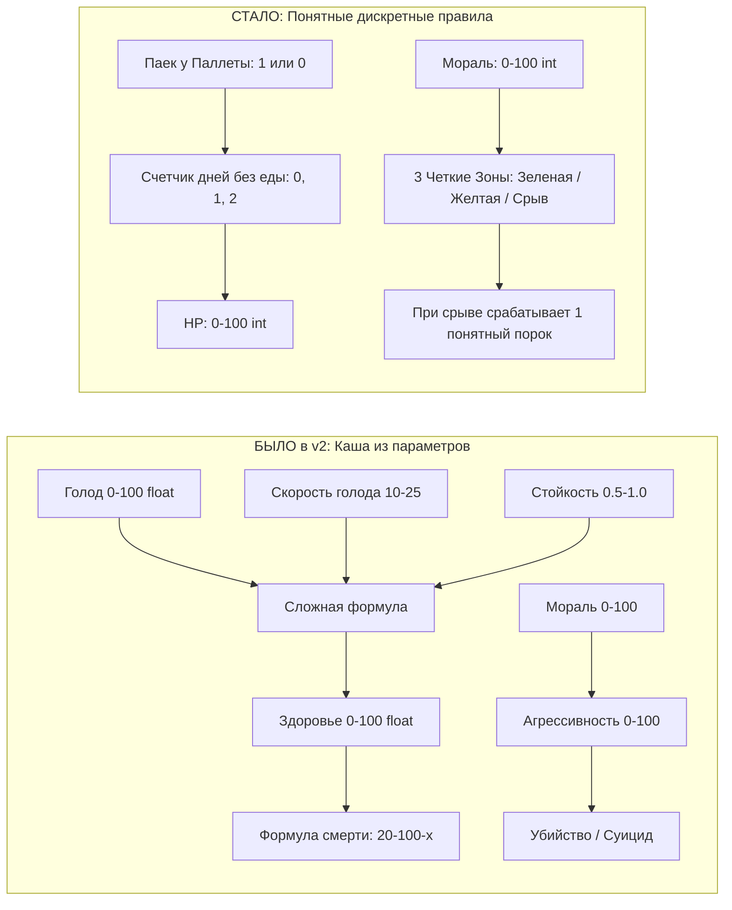

# ⚙️ Упрощенная система параметров и связей (Без скрытого перегруза)

> **Главная проблема оригинала:** 5 открытых + 5 скрытых float-параметров, 10 особенностей и перекрестные дробные формулы (`(50-x)*0.15*стойкость`) создавали **комбинаторный взрыв**. Балансировать и тестировать такую паутину за 1.5 недели невозможно — персонажи либо погибали в случайный момент, либо не реагировали на действия.
> 
> **Решение:** Полный переход на **целочисленные шкалы (Integers)** и **дискретные статусы (Правила вместо формул)**. Это сохраняет 100% драмы и напряжения, но пишется за 1 день и не ломается при балансировке!

---

## 1. Сравнение систем: Было (v2) vs Стало

---

## 2. Параметры выжившего (Всего 3 открытых параметра + 1 скрытая тайна)

### 1. ❤️ Здоровье (HP: 0–100, целое число)
Физическое состояние тела. Отображается полоской или сердечками на [[06_Точки_интеракции_3D_комнаты#3. 📌 Доска расследования (Investigation Board) — Досье и Слежка|Доске расследования]].

* **100–75 (Здоров):** Максимальная работоспособность. Может идти в любые экспедиции.
* **74–35 (Ранен / Ослаблен):** Может выполнять ремонт в бункере, но шанс травмы на вылазках возрастает.
* **34–1 (Тяжелоболен / При смерти):** Не может работать и идти на вылазки. Только отдых в кровати.
* **0 (СМЕРТЬ):** Персонаж погибает навсегда.
  - **Следствие смерти:** Все остальные жильцы мгновенно получают **-20 к Морали** (шок и траур).

---

### 2. 🧠 Мораль / Рассудок (0–100, целое число)
Психологическая устойчивость. Разделена на **3 очевидные зоны**:

| Зона морали | Значение | Состояние | Поведение персонажа |
| :--- | :--- | :--- | :--- |
| 🟢 **Зеленая** | 60–100 | **Стабилен** | Идеально выполняет приказы, шанс конфликта 0%. |
| 🟡 **Желтая** | 30–59 | **На взводе** | Ворчит, жалуется, эффективность ремонта падает. |
| 🔴 **Красная** | 0–29 | **ПСИХОЗ (Срыв)** | **Ночью активируется Скрытый порок!** Отказ работать днем. |

**Что снижает мораль (четкие триггеры):**
- Смерть любого сожителя: **-20**
- Ночь в замерзающем бункере (уровень холода 0 или 1): **-15**
- День без воды: **-15**
- День без еды: **-10**
- Комендант выгнал кого-то на мороз: **-20**

**Что поднимает мораль:**
- Успешная вылазка с богатой добычей: **+15**
- Отдых на кровати / чай у буржуйки: **+20**
- Утешение от Дипломата: **+15**
- Позитивное решение дневного ивента у Гермодвери: **+10–20**

---

### 3. 🍞 Статус питания и воды (Счетчики дней вместо float-шкал)
Вместо отслеживания дробных чисел голода от 0 до 100 и скоростей списания:

#### 🥫 Еда (Управляется у [[06_Точки_интеракции_3D_комнаты#6. 📦 Паллеты с едой (Food Pallets) — Кладовая и Пайки|Паллет с едой]]):
- **День 0 (Сыт):** Получил банку консервов вчера. Все статы в норме.
- **День 1 (Голоден):** Не получил еду 1 день. Мораль -10, HP не падает.
- **День 2+ (Истощен):** Не ел 2 дня подряд. **Теряет -25 HP каждое утро**, Мораль -20.
- *Как вылечить:* Выдать банку еды — статус сразу сбрасывается на «Сыт».

#### 💧 Вода (Управляется у [[06_Точки_интеракции_3D_комнаты#4. 🚰 Водопроводные трубы (Water Pipes) — Раздача воды и Ремонт|Водопроводных труб]]):
- **День 0 (Напоен):** Получил канистру воды вчера.
- **День 1 (Жажда):** Не пил 1 день. Мораль -15, запрет на выход в экспедицию.
- **День 2+ (Обезвоживание):** Не пил 2 дня подряд. **Теряет -40 HP каждое утро!** Если не напоить на 3-й день — гарантированная смерть.

> 💡 **Почему это гениально для 1.5 недель?**
> Игроку не нужно высчитывать миллилитры. Он видит значок: «Голоден» или «Жажда». Логика в коде пишется как `daysWithoutFood++` и `if (daysWithoutFood >= 2) TakeDamage(25)`. Ноль багов!

---

## 3. Замена скрытых float-параметров на Дискретные Пороки

В оригинале были скрытые шкалы: *«Скорость голодания 10-25», «Стойкость 0.5-1.0», «Агрессивность 0-100», «Стрессоустойчивость 0-100»*.  
В Компактной версии каждый персонаж имеет **1 открытую профессию** и **1 скрытую черту (Порок)**, которая срабатывает только при падении Морали в Красную зону (< 30):

| Персонаж | Открытая профессия | Скрытая черта (Порок) | Что делает порок при срыве (Мораль < 30) |
| :--- | :--- | :--- | :--- |
| **Механик** | 100% чинит генератор, +1 топлива | **Клептоман** | Ночью крадет 1 ресурс (топливо или консерву) и прячет под койку. |
| **Доктор** | Лечит больного на +35 HP за день | **Морфинист** | При отсутствии воды впадает в ломку: HP -30, теряет способность лечить. |
| **Ветеран** | +25% шанс успеха опасных вылазок | **Агрессор (ПТСР)** | Ночью устраивает драку: наносит -35 HP случайному соседу! |
| **Повар** | 4 человека едят за 3 банки еды | **Параноик** | Если за ней следить, блокирует склад: еду нельзя распределять 1 день. |
| **Дипломат** | Держит мораль группы (+15 соседям) | **Фанатик-вредитель** | Считает холод карой свыше: ночью пытается отключить генератор! |
| **Сталкер** | Находит в 1.5 раза больше лута | **Астматик** | При температуре «Холодно» задыхается: теряет -25 HP за ночь. |

---

## 4. Как работает Слежка на практике

1. Игрок подходит к [[06_Точки_интеракции_3D_комнаты#3. 📌 Доска расследования (Investigation Board) — Досье и Слежка|Доске расследования]].
2. Выбирает: *«Назначить Батю следить за Дмитрием (Дипломатом)»*.
3. Ночью Батя не спит, а наблюдает.
4. Утром у [[06_Точки_интеракции_3D_комнаты#7. 🚪 Гермодверь (Door) — Дневные ЧП и Конверты доносов|Гермодвери]] лежит конверт.
5. Игрок открывает конверт и видит четкий текст:
   > ✉️ *«Доклад дежурного: Я видел, как Дмитрий шептал молитвы возле щитка и вытащил предохранитель. Он безумен и отключит генератор, если его мораль упадет!»*
6. На Доске расследования у Дмитрия навсегда снимается плашка тайны и загорается надпись: `[Порок: Фанатик-вредитель]`.
7. Теперь игрок знает: Дмитрия **нельзя** доводить до психоза, либо его нужно заранее выгнать из бункера через [[06_Точки_интеракции_3D_комнаты#2. 💻 ПК / Терминал (PC) — Экспедиции и Решения|ПК]]!

---

## 5. Общие параметры убежища (Склад и Климат)

Вместо непрерывных величин в бункере всего **4 прозрачных показателя**:

1. **🥫 Провизия (Штуки, int):** Раздается у Паллет. Приход — с вылазок.
2. **💧 Вода (Штуки, int):** Раздается у Труб. Приход — с вылазок.
3. **⚙️ Топливо / Запчасти (Штуки, int):** Тратится у Щитка на обогрев (1 ед./ночь) и ремонт.
4. **🌡️ Температура базы (4 ступени):**
   - `3: Тепло` — все в норме, генератор гудит.
   - `2: Прохладно` — топливо кончилось или генератор встал. Иней на стеклах.
   - `1: Холод` — замерзание. Все получают -15 HP за ночь, -10 морали. Астматик теряет -25 HP.
   - `0: Обледенение` — смертельный мороз! Все получают -35 HP за ночь. Через 2 ночи в живых не останется никого.

---

## 6. Механика поломок (Понятные вероятности)

Поломки происходят только при переходе ночи и зависят от состояния бункера:

* **Водопровод ([[06_Точки_интеракции_3D_комнаты#4. 🚰 Водопроводные трубы (Water Pipes) — Раздача воды и Ремонт|Трубы]]):**
  - Базовый шанс аварии за ночь: **20%**.
  - Если в бункере «Холод» (замерзание труб): шанс возрастает до **50%**.
  - Если сломался — пока не отремонтирован, воду выдать нельзя!
* **Генератор ([[06_Точки_интеракции_3D_комнаты#5. ⚡ Электрощиток / Генератор (Electrical Panel) — Тепло и Энергия|Щиток]]):**
  - Базовый шанс поломки за ночь: **15%**.
  - Если в колонии есть невскрытый Саботажник в красной зоне морали: **100% поломка ночью!**
  - Починка обычным человеком: 60% успех, 40% травма током (-30 HP).
  - Починка Механиком: 100% мгновенный безопасный успех.

---

## 7. Формула успеха вылазки ([[06_Точки_интеракции_3D_комнаты#2. 💻 ПК / Терминал (PC) — Экспедиции и Решения|ПК]])

Вместо сложного матана с тремя делениями выносливости:

$$\text{Шанс Успеха} = \text{Базовый шанс локации} + \text{Бонус за 2-го человека (+20\%)} + \text{Бонус профессии (+25\%)} - \text{Штраф за ранения (-20\%)}$$

*Если кубик (рандом 1..100) выбросил значение выше шанса успеха:*
- Разница ушла в ранение участника (-35 HP).
- Если значение броска > 90% и локация опасная — гибель одного из участников.

Все прозрачно, легко пишется за 30 строк кода и отлаживается за 15 минут в Unity Editor!
