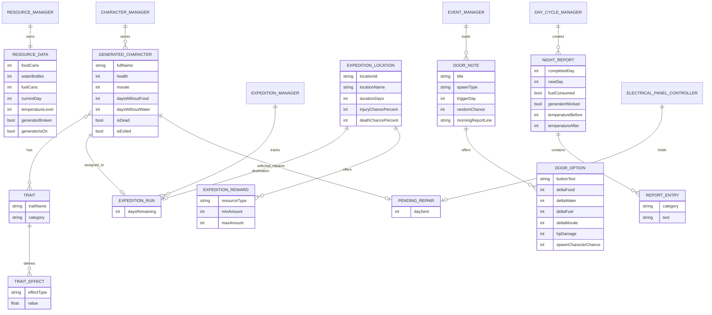

# Архитектура игры — схема по исходному коду

> Схема отражает текущую реализацию Unity-проекта, а не планируемую архитектуру. Основной фокус — игровой цикл дня/ночи и система генератора: её состояния, данные и связи с остальными подсистемами.

## 1. Архитектурный граф

```mermaid
flowchart LR
    Player["Игрок"]
    Interactor["Interactor<br/>луч, ввод, интерфейсы интеракции"]
    WorldPanel["InteractElectricalPanel<br/>объект электрощитка"]
    PanelUI["ElectricalPanelUI<br/>отображение и кнопки"]
    PanelController["ElectricalPanelController<br/>правила генератора и ремонта"]
    Resources["ResourceManager<br/>единая точка изменения запасов"]
    ResourceData["ResourceData<br/>запасы, день и состояние генератора"]
    Characters["CharacterManager<br/>список жителей и рационы"]
    Character["GeneratedCharacter<br/>состояние жителя и черты"]
    Traits["Trait ScriptableObject<br/>эффекты черт"]
    Expeditions["ExpeditionManager<br/>занятость жителей и возвраты"]
    Bed["BedSleepTrigger / InteractBed<br/>запуск сна и показ результата"]
    DayCycle["DayCycleManager<br/>порядок обработки ночи"]
    Report["NightReportData<br/>результаты ночи"]
    ReportUI["MorningReportPanel<br/>утренняя сводка"]
    Events["EventManager<br/>события у двери"]

    Player --> Interactor
    Interactor -->|"Interact()"| WorldPanel
    WorldPanel -->|"Open()"| PanelUI
    PanelUI -->|"команды и Refresh()"| PanelController
    PanelController -->|"чтение/изменение состояния"| Resources
    Resources --> ResourceData
    PanelController -->|"отбор и состояние ремонтника"| Characters
    Characters --> Character
    Character --> Traits
    PanelController -->|"проверка экспедиции"| Expeditions
    Bed -->|"StartNextDay()"| DayCycle
    DayCycle -->|"топливо, температура, запасы"| Resources
    DayCycle -->|"выживание и рационы"| Characters
    DayCycle -->|"обработка завершённых походов"| Expeditions
    DayCycle -->|"ProcessGeneratorNight(report)"| PanelController
    PanelController -->|"поломка/ремонт; событие ресурсов"| Resources
    DayCycle -->|"заполняет и публикует"| Report
    PanelController -->|"добавляет особые события"| Report
    Report -->|"OnNightComplete"| Bed
    Bed -->|"Show(report)"| ReportUI
    DayCycle -->|"OnDayChanged"| Events
    Events -->|"утренние строки"| Report
```

Стрелка `A → B` означает передачу команды, данных или события; подпись уточняет контракт. `ResourceData` и `GeneratedCharacter` — данные, которыми владеют соответствующие менеджеры, а не отдельные сервисы.

## 2. Назначение модулей, входы и результаты

| Модуль | Назначение | Основные входы | Результат и обмен |
|---|---|---|---|
| `Interactor` | Ищет объект под указателем лучом камеры, запускает взаимодействие и подсветку. | Ввод мыши, камера, физический объект в пределах дистанции. | Вызывает `IInteractable.Interact()` и `IHighlightable.Highlight()`. |
| `InteractElectricalPanel` | Соединяет объект электрощитка в сцене с UI. | Вызов `Interact()`, назначенная ссылка на `ElectricalPanelUI`. | Открывает UI; подсветка меняет параметр материала. |
| `ElectricalPanelUI` | Показывает температуру, топливо, статус и список ремонтников; принимает нажатия. | Данные через менеджеры, события ресурсов/генератора/экспедиций и нажатия кнопок. | Вызывает команды контроллера и обновляет экран через `Refresh()`. |
| `ElectricalPanelController` | Проверяет возможность переключения и ремонта; рассчитывает вероятность поломки, успеха и травмы. | Команды UI, `ResourceManager`, `CharacterManager`, `ExpeditionManager`, черты жителей и `NightReportData`. | Меняет состояние генератора/здоровье, держит текущую заявку на ремонт, добавляет особые события в отчёт, публикует события для UI. |
| `ResourceManager` | Управляет запасами, температурой и состоянием генератора; рассылает уведомление об изменении. | Запросы потребления/добавления, изменения температуры, включения, поломки или ремонта. | Меняет `ResourceData` и вызывает `OnResourcesChanged`. |
| `CharacterManager` | Хранит жителей и меняет рационы; создаёт игровые карточки. | Действия игрока, генератор персонажей, события завершения ночи. | Обновляет список `GeneratedCharacter`, расходы еды/воды и UI карточек. |
| `ExpeditionManager` | Учитывает активные походы и доступность жителей. | Назначение персонажа и локации, завершение игрового дня. | Сообщает, кто находится в экспедиции; завершает походы и дополняет отчёт/запасы. |
| `DayCycleManager` | Оркестрирует ночное обновление в строгом порядке. | `StartNextDay()` от сна; ссылки на менеджеры систем. | Списывает топливо, меняет температуру, обновляет выживание, походы, генератор, мораль; публикует отчёт и события победы/поражения. |
| `NightReportData` | Временный пакет результатов одной ночи. | Итоги менеджеров, включая поломку/ремонт генератора. | Передаётся подписчикам `OnNightComplete` и отображается как сводка. |
| `BedSleepTrigger` / `MorningReportPanel` | Блокируют управление на время сна, показывают отчёт и возвращают управление после продолжения. | Нажатие «Спать», события цикла, `NightReportData`. | Экран сводки либо экран победы/поражения; затем возобновление управления. |
| `InteractBed` | Альтернативный компонент сна через взаимодействие с объектом кровати. | `IInteractable.Interact()` и события `DayCycleManager`. | Также вызывает `StartNextDay()` и показывает отчёт; какой сценарий используется, зависит от компонентов сцены. |
| `EventManager` | Выбирает события у двери и применяет выбранные последствия; подготавливает строки для сводки. | Новый день, данные `DoorNoteData`, выбор игрока. | Меняет запасы/мораль/здоровье и может создать жителя; отдаёт строки утренних событий. |

### Контракты ключевых взаимодействий

- **Обновление UI:** `ResourceManager.OnResourcesChanged` → `ElectricalPanelController.HandleResourcesChanged()` → `OnResourcesChanged` и `OnGeneratorStatusChanged` → `ElectricalPanelUI.Refresh()`.
- **Экспедиции:** UI строит список ремонта по `GetAvailableRepairCharacters()`. Умершие, изгнанные, отправленные в экспедицию и имеющие эффект `CannotRepairElectricity` жители не предлагаются.
- **Заявка на ремонт:** `SendCharacterForRepair(character, out message)` проверяет выбранного жителя, поломку и отсутствие другой заявки. Успешная заявка хранит ссылку на жителя до ночной обработки.
- **Ночь:** `BedSleepTrigger` вызывает `DayCycleManager.StartNextDay()`. Последний формирует один `NightReportData` и передаёт тот же объект системам и экрану сводки.
- **Запуск сна:** в коде есть два компонента, вызывающих один и тот же переход: `BedSleepTrigger` (кнопка) и `InteractBed` (взаимодействие с кроватью). Наличие обоих классов не доказывает, что оба одновременно используются в сцене.
- **Результат:** `MorningReportPanel` форматирует поля отчёта, а не пересчитывает игровые правила.

## 3. Блок-схема: включение и ночная обработка генератора

```mermaid
flowchart TD
    Begin["Игрок открывает электрощиток"]
    Action{"Действие игрока?"}
    Toggle["Нажатие кнопки питания"]
    HasResourceManager{"ResourceManager назначен?"}
    BrokenNow{"Генератор сломан?"}
    WantsOn{"Новое состояние — включено?"}
    CanStart{"Есть топливо и генератор исправен?"}
    SetPower["SetGeneratorOn(новое состояние)"]
    RepairList["Показать доступных ремонтников"]
    Selected{"Ремонтник выбран?"}
    BrokenForRepair{"Генератор сломан?"}
    Pending{"Уже есть заявка на ремонт?"}
    Eligible{"Персонаж жив, в бункере<br/>и может ремонтировать?"}
    QueueRepair["Сохранить ремонтника<br/>как ожидающую заявку"]
    Denied["Отказ / состояние не изменено"]
    ReadySleep["Игрок решает запустить сон"]
    StartSleep["Игрок запускает сон"]
    SleepEntry["BedSleepTrigger или InteractBed<br/>затемнение и блокировка управления"]
    DayStart["DayCycleManager начинает новый день"]
    IsRunning{"Генератор включён и не сломан?"}
    ConsumeFuel{"Удалось списать 1 топливо?"}
    Warm["Температура +1; generatorWorked = true"]
    Cool["Температура -1; generatorWorked = false"]
    Survival["Обновить выживание жителей и рационы"]
    Expeditions["Обработать экспедиции"]
    BreakdownCheck{"Генератор работал этой ночью<br/>и ещё не сломан?"}
    BreakdownChance["Рассчитать шанс поломки:<br/>жители в бункере и эффекты черт"]
    Broke{"Случилась поломка?"}
    Break["BreakGenerator(); записать событие"]
    HasRepair{"Есть ожидающая заявка на ремонт?"}
    RepairChance["Рассчитать шанс ремонта:<br/>базовый шанс + бонус за жителей"]
    RepairSuccess{"Ремонт успешен?"}
    Repair["RepairGenerator(); записать успех"]
    InjuryTrait{"Черта запрещает травму?"}
    InjuryChance["Рассчитать шанс травмы<br/>с учётом черт"]
    Injury{"Персонаж получил травму?"}
    Damage["Снять HP; при HP ≤ 0<br/>отметить смерть в отчёте"]
    Failure["Записать неудачу без травмы"]
    ClearRequest["Очистить заявку на ремонт"]
    Morale["Применить штрафы морали<br/>и проверить уход жителей"]
    Publish["Опубликовать NightReportData"]
    Outcome{"Все жители потеряны?"}
    Defeat["Событие поражения"]
    Victory{"Завершён 10-й день?"}
    Win["Событие победы"]
    Report["Показать утреннюю сводку"]
    Finish["Завершить переход дня"]

    Begin --> Action
    Action -->|"питание"| Toggle
    Action -->|"ремонт"| RepairList
    Toggle --> HasResourceManager
    HasResourceManager -->|"нет"| Denied
    HasResourceManager -->|"да"| BrokenNow
    BrokenNow -->|"да"| Denied
    BrokenNow -->|"нет"| WantsOn
    WantsOn -->|"нет: выключить"| SetPower
    WantsOn -->|"да"| CanStart
    CanStart -->|"нет"| Denied
    CanStart -->|"да"| SetPower
    RepairList --> Selected
    Selected -->|"нет"| Denied
    Selected -->|"да"| BrokenForRepair
    BrokenForRepair -->|"нет"| Denied
    BrokenForRepair -->|"да"| Pending
    Pending -->|"да"| Denied
    Pending -->|"нет"| Eligible
    Eligible -->|"нет"| Denied
    Eligible -->|"да"| QueueRepair
    SetPower --> ReadySleep
    QueueRepair --> ReadySleep
    ReadySleep --> StartSleep --> SleepEntry
    SleepEntry --> DayStart --> IsRunning
    IsRunning -->|"да"| ConsumeFuel
    IsRunning -->|"нет"| Cool
    ConsumeFuel -->|"да"| Warm
    ConsumeFuel -->|"нет"| Cool
    Warm --> Survival
    Cool --> Survival
    Survival --> Expeditions --> BreakdownCheck
    BreakdownCheck -->|"нет"| HasRepair
    BreakdownCheck -->|"да"| BreakdownChance --> Broke
    Broke -->|"нет"| HasRepair
    Broke -->|"да"| Break --> HasRepair
    HasRepair -->|"нет"| Morale
    HasRepair -->|"да"| RepairChance --> RepairSuccess
    RepairSuccess -->|"да"| Repair --> ClearRequest
    RepairSuccess -->|"нет"| InjuryTrait
    InjuryTrait -->|"да"| Failure
    InjuryTrait -->|"нет"| InjuryChance --> Injury
    Injury -->|"да"| Damage --> ClearRequest
    Injury -->|"нет"| Failure --> ClearRequest
    ClearRequest --> Morale
    Morale --> Publish
    Publish --> Outcome
    Outcome -->|"да"| Defeat
    Outcome -->|"нет"| Victory
    Victory -->|"да"| Win
    Victory -->|"нет"| Report
    Defeat --> Finish
    Win --> Finish
    Report --> Finish
```

### Существенные ветвления и правила

1. Нельзя включить сломанный генератор или генератор без топлива; выключить исправный генератор можно. UI-кнопка переключения также блокируется, если генератор сломан.
2. При ночном списании топлива успех даёт `+1` к температуре, а неудача — `−1`. Если генератор выключен или уже сломан, топливо не списывается, температура всё равно снижается.
3. Вероятность поломки проверяется только если `report.generatorWorked == true`. Базовая зависимость от жителей: 60% при одном человеке, далее минус 10 процентных пунктов на каждого дополнительного; эффекты черт добавляются, итог ограничивается диапазоном 0–100%.
4. Заявка на ремонт разрешается после проверки ночной поломки. Шанс успеха по умолчанию — 60% плюс 10 процентных пунктов за каждого дополнительного живого жителя в бункере; успех восстанавливает генератор. При неудаче базовый шанс травмы — 25%, урон по умолчанию — 15 HP. Эффекты `NoInjuryOnGeneratorRepair`, `ElectricityRepairInjuryChanceChangePoints` и `ElectricityRepairInjuryChanceReductionPercent` влияют на травму; итоговый шанс травмы ограничивается диапазоном 0–100%.
5. Для ремонтника учитываются только живые, не изгнанные жители в бункере; присутствие в экспедиции исключает жителя.
6. После ночной обработки `DayCycleManager` публикует `OnNightComplete`, а затем добавляет в тот же отчёт строки `EventManager`. Подписчики получают ссылку на общий изменяемый объект `NightReportData`.

## 4. Схема данных

Это логическая схема игровых объектов в памяти Unity, а не схема SQL-базы. `ResourceData` сериализуем, `GeneratedCharacter` — сериализуемый объект в списке `CharacterManager`; `Trait`, `ExpeditionLocationData` и `DoorNoteData` — `ScriptableObject`-данные. `NightReportData` создаётся для обработки ночи и передачи UI.

### Как читать схему

- `ResourceManager` владеет одним объектом `ResourceData`; фактические запасы меняются методами менеджера, а не напрямую из UI.
- `CharacterManager` хранит набор жителей. У каждого жителя могут быть черты; одна и та же запись-ассет `Trait` может использоваться несколькими жителями, а черта содержит список `TraitEffect`.
- `ExpeditionRun` связывает отправленного жителя и локацию на ограниченное число дней. Активные походы учитываются при выборе ремонтника и расчёте числа людей в бункере.
- `EventManager` загружает набор `DoorNoteData`; у каждой заметки есть варианты `Option`, которые меняют запасы и состояние жителей.
- `NightReportData` содержит не только строковые категории отчёта (`resourceChanges`, `survivalChanges`, `deaths`, `departures`, `expeditionReturns`, `specialEvents`, `secretReports`), но и структурированные итоги топлива, температуры и дней.
- `PENDING_REPAIR` — концептуальное обозначение состояния в `ElectricalPanelController` (`pendingRepairCharacter`, `pendingRepairDaySent`), а не отдельная сохраняемая сущность. У контроллера одновременно не более одной заявки.
- `REPORT_ENTRY` — условное представление строковых списков отчёта для диаграммы; в коде отдельного класса такой записи нет.
- Схема описывает используемые в этой игровой петле данные, а не все объекты и UI-сцены проекта.

## 5. Исходники, по которым сверена схема

- `Assets/Scripts/Interaction/Interactor.cs`
- `Assets/Scripts/Interaction/InteractElectricalPanel.cs`
- `Assets/Scripts/UI/ElectricalPanelUI.cs`
- `Assets/Scripts/Interaction/ElectricalPanelController.cs`
- `Assets/Scripts/Resources/ResourceManager.cs`
- `Assets/Scripts/Resources/ResourceData.cs`
- `Assets/Scripts/Character/CharacterManager.cs`
- `Assets/Scripts/Character/GeneratedCharacter.cs`
- `Assets/ScriptableObjects/Trait.cs`
- `Assets/Scripts/ExpeditionManager.cs`
- `Assets/Scripts/ExpeditionLocationData.cs`
- `Assets/Scripts/DayCycleManager.cs`
- `Assets/Scripts/Core/NightReportData.cs`
- `Assets/Scripts/Interaction/BedSleepTrigger.cs`
- `Assets/Scripts/Interaction/InteractBed.cs`
- `Assets/Scripts/UI/MorningReportPanel.cs`
- `Assets/Scripts/Door/EventManager.cs`
- `Assets/Scripts/Door/DoorNoteData.cs`
