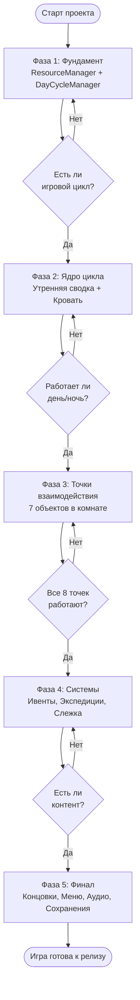

# 🗺️ План реализации игры «Холодный Ковчег»

Блок-схема по шагам с вариантами ветвления. Сохранять в Obsidian (поддерживает Mermaid).

---

## 🧭 Общая блок-схема разработки




## 📋 Пошаговый план с вариантами ветвления

### Этап 1: Фундамент (P0 — критично)

#### 1.1 ResourceManager
- [ ] Создать скрипт `ResourceManager.cs` (Singleton)
- [ ] Поля: `foodCans`, `waterBottles`, `fuelCans`, `temperatureLevel` (0–3), `generatorBroken`
- [ ] Методы: `ConsumeFood()`, `ConsumeWater()`, `ConsumeFuel()`, `Add*()`, `SetTemperature()`
- [ ] Событие `OnResourcesChanged` для UI
- [ ] Стартовые значения по диздоку: еда 8–10, вода 8–10, топливо 4–6, температура 3

**Ветвление:**
- Если работаешь **в одиночку** → сделай ResourceManager первым, без него дальше нечего считать.
- Если в **команде** → ResourceManager отдаёшь программисту 1, а программист 2同時 начинает UI-заготовки.

#### 1.2 DayCycleManager
- [ ] FSM: `Morning` → `Day` → `Night` → `Morning`
- [ ] Счётчик дней 1–10
- [ ] Ночной расчёт:
  - Потратить 1 топливо (если генератор работает)
  - Если нет топлива/генератор сломан → температура −1
  - Голод/жажда: `daysWithoutFood++`, `daysWithoutWater++`
  - Урон HP и мораль по статусам (из диздока)
  - Проверка死亡
  - Возвращение экспедиций
  - Конверт слежки (если был шпион)
- [ ] Проверка концовок: день == 10 → Победа; живых == 0 → Поражение

**Ветвление:**
- Если **времени мало** → упрости ночной расчёт: только еда и температура, без воды и болезней.
- Если **есть время** → добавь все статы по `Открытые параметры.md`.


### Этап 2: Ядро цикла (P0)

#### 2.1 Утренняя сводка (Morning Report)
- [ ] Создать UI-панель `MorningReportPanel`
- [ ] Текст: результаты ночи (потрачено топлива, температура, еда/вода, урон, смерти, лут с экспедиции, конверт слежки)
- [ ] Кнопка «Закрыть» → переход к фазе `Day`

#### 2.2 Точка взаимодействия: Кровать
- [ ] Скрипт `InteractBed.cs` (паттерн как `InteractPC`)
- [ ] При нажатии → переход в фазу `Night` (Fade to Black)
- [ ] После ночи → переход к `Morning` следующего дня

**Ветвление:**
- Если **кровать ещё не моделирована** → используй куб-заглушку с коллайдером и `InteractBed`.
- Если **модель кровати есть** → повесь на неё `InteractBed` и настрой outline-подсветку.


### Этап 3: Точки взаимодействия (P1)

Нужно реализовать 7 точек (плюс ПК уже есть):

| Точка | Скрипт | Действие |
|-------|--------|----------|
| Доска расследования | `InteractBoard.cs` | Карточки персон, назначение слежки |
| Трубы водопровода | `InteractPipes.cs` | Раздача воды, ремонт засора |
| Электрощиток | `InteractPanel.cs` | Топливо, температура, починка генератора |
| Паллеты с едой | `InteractPallets.cs` | Раздача пайков |
| Гермодверь | `InteractDoor.cs` | Кризисные ивенты, конверт утром |
| Картина | `InteractPicture.cs` | Лор/атмосфера |
| ПК | `InteractPC.cs` | **Уже есть** |

**Порядок реализации:**
1. Доска расследования (связана со слежкой и досье)
2. Паллеты с едой (распределение пайков — нужно для выживания)
3. Трубы (вода)
4. Электрощиток (топливо/температура)
5. Гермодверь (ивенты)
6. Картина (декоративно, можно в конце)

**Ветвление:**
- Если **UI ещё не готов** → сделай все точки как заглушки: при нажатии просто `Debug.Log` + текст в консоли. UI прикрутишь позже.
- Если **UI готов** → каждая точка открывает своё окно (как ПК переключает камеру).


### Этап 4: Системы (P1)

#### 4.1 Система ивентов (15 дилемм)
- [ ] `EventManager.cs` со списком событий из `Выборы.md`
- [ ] Модальное окно: заголовок, текст, 2–3 кнопки выбора
- [ ] Проверка условий: нужна ли профессия (Механик, Доктор, Ветеран)
- [ ] Применение последствий: ресурсы, мораль, HP, изгнание, секрет

#### 4.2 Экспедиции
- [ ] Карта с 3 локациями (Супермаркет, Поликлиника, ТЭЦ/Автобаза)
- [ ] Выбор 1–2 человек
- [ ] Бросок кубика с шансом успеха/ранения/смерти
- [ ] Лут утром следующего дня

#### 4.3 Слежка и секреты
- [ ] Назначение шпиона на Доске расследования
- [ ] Ночное дежурство → утренний конверт у Гермодверя
- [ ] `isSecretRevealed = true` для цели
- [ ] Риск: Параноик замечает хвост → мораль −0, склад блокируется

**Ветвление:**
- Если **не успеваешь к демо** → оставь только ивенты (без экспедиций и слежки). Экспедиции замени на простой текст «принесли еду» утром.
- Если **всё успеваешь** → делай полноценно по диздоку.

### Этап 5: Финал и полировка (P2/P3)

#### 5.1 Экраны концовок
- [ ] Победа «Триумф общины» (4–5 выживших, мораль > 60)
- [ ] Победа «Тяжелая победа» (2–3 выживших)
- [ ] Победа «Выживший в одиночку» (1 выживший)
- [ ] Поражение «Ледяной склеп» (все мертвы)

#### 5.2 Главное меню
- [ ] Новая игра / Загрузить / Выход
- [ ] Подключение к сцене «Для тестов 1»

#### 5.3 Аудио (AudioManager)
- [ ] Фоновая метель, звук генератора
- [ ] Звуки кнопок, fade при смене дня

#### 5.4 Сохранение/загрузка
- [ ] JSON или PlayerPrefs: день, ресурсы, состояние персонажей


---

## 🔀 Варианты ветвления задач (что выбрать)

```
Начало
│
├─► ОДИН РАЗРАБОТЧИК
│   ├─ ResourceManager → DayCycleManager → Утренняя сводка → Кровать → 7 точек → Ивенты → Концовки
│   └─ Если застрял на UI → сделай серый прототип без визуальов, только текст и консоль
│
├─► КОМАНДА (2+ человека)
│   ├─ Программист 1: ResourceManager, DayCycleManager, ночной расчёт
│   ├─ Программист 2: UI, точки взаимодействия, ивенты
│   ├─ Художник: модели комнаты, карточки, иконки
│   └─ Геймдизайнер: баланс, тексты ивентов, завершённость
│
├─► МАЛО ВРЕМЕНИ (дедлайн близко)
│   ├─ Ресурсы + цикл день/ночь (P0)
│   ├─ Только кровать и паллеты с едой (остальные точки — заглушки)
│   ├─ Без экспедиций, без слежки, без звука
│   └─ Концовки простые (победа/поражение без 3 вариаций)
│
└─► ХОЧЕШЬ ПОЛНАЯ ИГРА
    ├─ Все P0 → P1 → P2 → P3 по порядку
    ├─ 3D-модели комнаты и 8 объектов
    ├─ Полное аудио и сохранения
    └─ Баланс и тестирование
```

---

## ✅ Критерии готовности каждой фазы

| Фаза | Готово, если... |
|------|-----------------|
| 1. Фундамент | Ресурсы тратятся и пополняются без ошибок, температура меняется |
| 2. Ядро цикла | Игра переключает дни 1→2→3, ночь наносит урон, есть победа/поражение |
| 3. Точки | Все 8 объектов в комнате кликабельны и делают своё дело |
| 4. Системы | Ивенты срабатывают, экспедиции возвращают лут, секреты раскрываются |
| 5. Финал | Есть меню, концовки, звук, игра запускается с начала до конца |

---

## 📂 Где что лежит

- `Assets\НТО\ЗАДАЧи.md` — основная доска задач (Kanban)
- `Assets\НТО\Заметка ResourceManager.md` — детальная заметка по ресурсам
- `Assets\НТО\Заметка DayCycleManager.md` — детальная заметка по циклу дня
- `Assets\НТО\Заметка Доска персонажей.md` — детальная заметка по доске
- `Assets\НТО\Заметка Система ивентов.md` — детальная заметка по ивентам
- `Assets\НТО\Задачи\План реализации по шагам.md` — этот файл

**Рекомендация:** начинай с **Фазы 1 (ResourceManager)** — без него не будет работать ничего другого.
