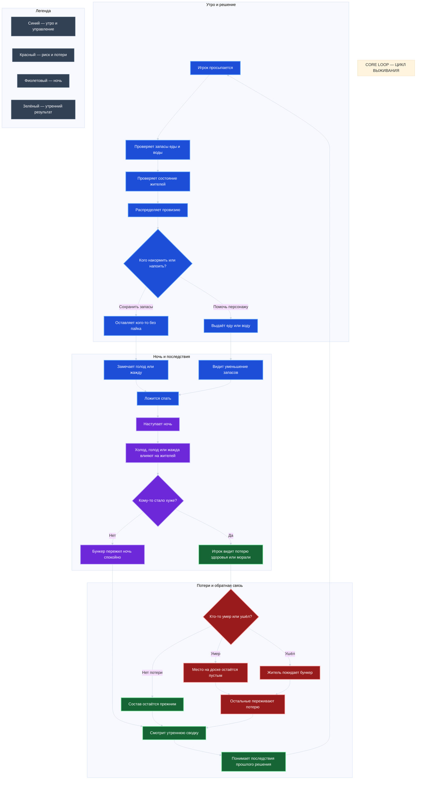
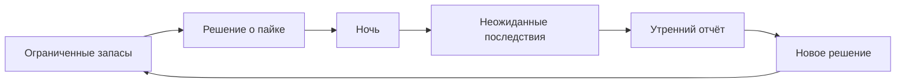

# Схема Core Loop

## Назначение

Core Loop — это самое короткое повторяющееся действие игрока:

> проверить бункер → распределить пайки → пережить ночь → увидеть последствия.

## Основная схема

## Что даёт микро-вызов игроку

Игрок постоянно решает:

- кто должен получить паёк;
- стоит ли оставить запас на завтра;
- можно ли позволить одному человеку голодать;
- хватит ли ресурсов до следующей ночи;
- готов ли бункер пережить ещё один день.

## Как игрок видит отклик

Каждое решение сопровождается понятной обратной связью:

- цифра запаса уменьшается;
- карточка персонажа показывает рацион;
- персонаж выглядит голодным, обезвоженным или раненым;
- ночью экран темнеет;
- утром открывается сводка;
- погибшие или ушедшие персонажи исчезают с доски;
- оставшиеся жители реагируют на потерю.

## Ощущение цикла

