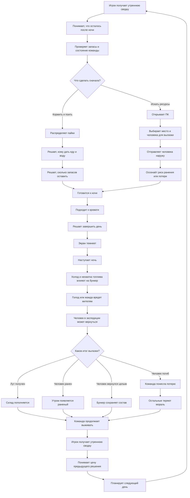
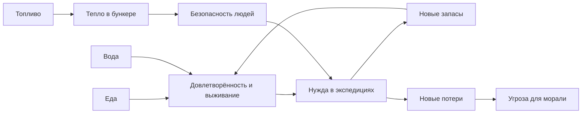
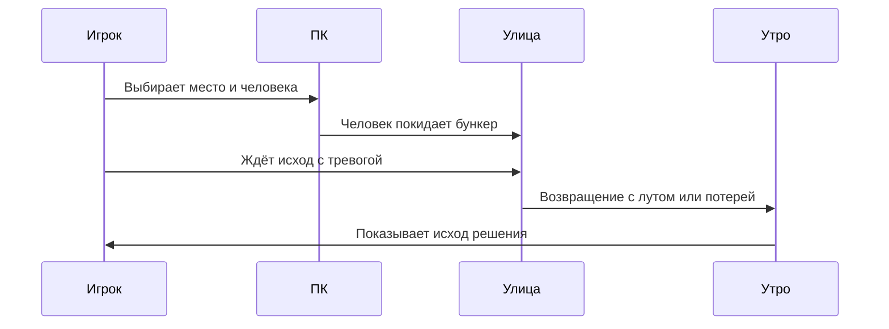

# Схема Game Loop

## Назначение

Game Loop — это путь игрока через один полный игровой день.

## Точка выбора

Игрок выбирает, куда направить ограниченные возможности:

- накормить всех или оставить запас;
- напоить каждого или сохранить воду;
- отправить человека в опасность ради ресурсов;
- оставить специалиста в бункере;
- рисковать ночью или подготовиться заранее.

## Синергия механик

## Как игрок переживает экспедицию

## Чем запоминается цикл

- каждый найденный ресурс связан с риском;
- запасы нужно планировать заранее;
- одна ошибка может привести к голодной или замёрзшей ночью;
- утро проверяет прошлые решения;
- с каждым днём потери становятся значительнее.
