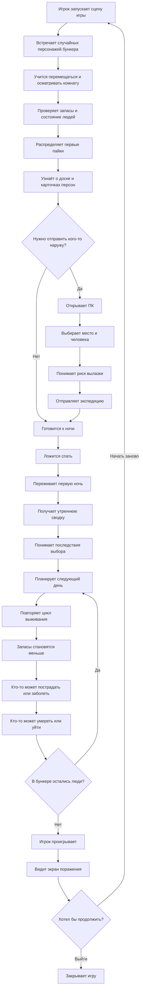
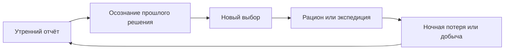
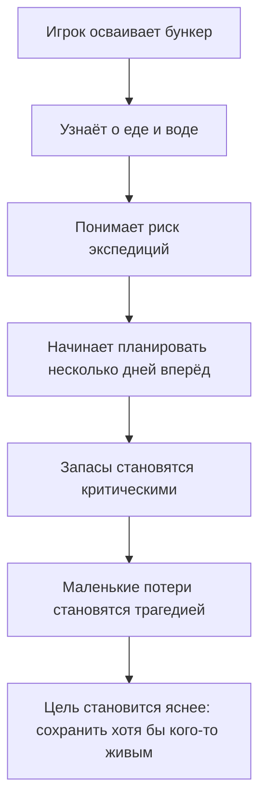
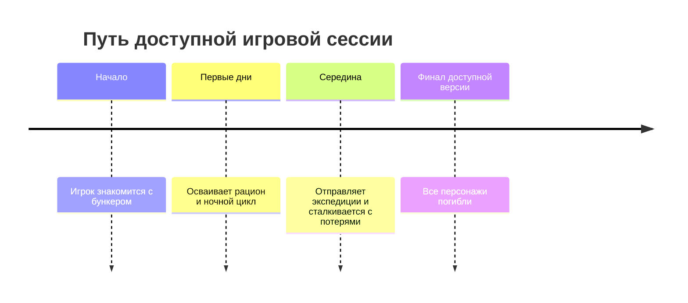
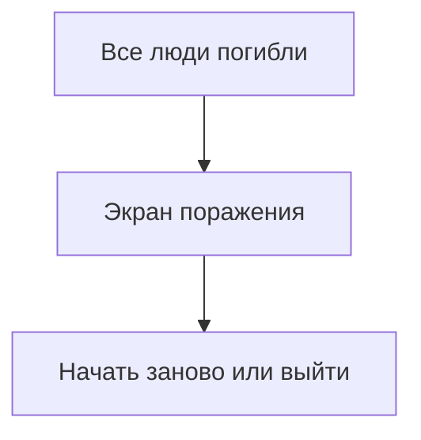

# Схема User Flow

## Назначение

User Flow показывает весь доступный сейчас путь игрока от запуска сцены до поражения или продолжения выживания.

## Связующие элементы

## Как развивается сессия

## Типовая структура сессии

## Выход из сессии

## Главный вывод для игрока

Сессия не состоит из отдельных меню. Это цепочка решений, где каждое утро показывает цену предыдущего дня.
