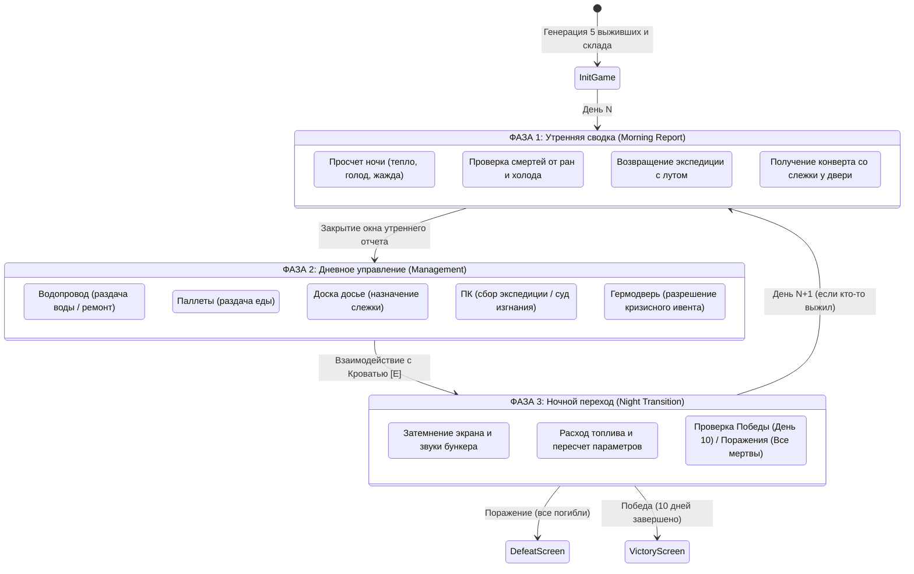

***
# Игровой цикл (Core Game Loop)

Игровой цикл состоит из трех последовательных фаз, повторяющихся каждый из 10 [[Дни|дней]]. Все расчеты происходят строго синхронно во время ночного перехода.

---

## Диаграмма состояний игрового цикла (FSM)

---

## 1. Фаза 1: Утренняя сводка (Morning Report)
Игрок «просыпается» в 3D комнате. Автоматически открывается экран утреннего отчета коменданта:
1. **Проверка систем жизнеобеспечения:**
   - Работал ли обогреватель от [[Электричество и тепло#Генератор|генератора]]? Если нет — температура упала, все жители получили урон от холода (-15 [[Открытые параметры#Здоровье|HP]]) и штраф к [[Открытые параметры#Мораль|морали]].
   - Исправен ли [[Вода#Поломка водопровода|водопровод]]?
2. **Пересчет состояния людей:**
   - Кто остался голоден или без воды — получают статус «Истощен» / «Обезвожен» и теряют здоровье.
   - Фиксация возможных [[Смерть|смертей]] за ночь.
3. **Возвращение [[Вылазки|экспедиции]]:**
   - Отчет о добыче: сколько принесли [[Еда|еды]], [[Вода|воды]], [[Электричество и тепло#Топливо|топлива/запчастей]], получили ли травмы.
4. **Конверт у [[Гермодверь|гермодвери]]:**
   - Если ночью работал шпион — на полу лежит конверт, вскрывающий [[Скрытые параметры|скрытую черту]] одного из персонажей.

---

## 2. Фаза 2: Дневное управление (3D Комната)
Игрок крутит камерой по комнате от 1-го лица (см. [[Перемещение и наводка]]) и взаимодействует с предметами (см. [[Предметы взаимодействия]]):
- У [[Паллеты с едой|паллет с едой]] раздает суточные пайки консервов.
- У [[Трубы|водопроводных труб]] поит жителей или назначает сантехника на устранение засора.
- У [[Электрощиток|электрощитка]] проверяет уровень тепла и топлива, чинит генератор.
- На [[Доска расследования|доске расследования]] изучает досье и назначает жителя на [[Слежка|слежку]].
- За [[ПК|терминалом ПК]] формирует и отправляет группу на [[Вылазки|вылазку]], либо принимает решение об изгнании опасного сожителя.
- У [[Гермодверь|гермодвери]] решает внезапные дневные [[Выборы|кризисные ситуации и дилеммы]].

---

## 3. Фаза 3: Завершение дня и переход ночи
1. Игрок наводится  [[Кровать|кровати]] и нажимает `[E] Лечь спать`.
2. Если ресурсы не распределены, система выдает предупреждение.
3. Экран плавно гаснет (Fade to Black).
4. Просчитывается расход топлива (1 ед. за ночь), пересчитываются статы.
5. Проверяются [[Концовки|условия окончания игры]]:
   - Если живых людей = 0 -> [[Концовки#Плохая концовка|Плохая концовка]].
   - Если день = 10 и хотя бы 1 человек жив -> [[Концовки#Хорошая концовка|Хорошая концовка]].
   - Иначе: счетчик `Дни++`, переход к Фазе 1 следующего дня.
