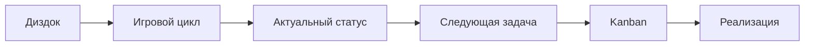

# Старт здесь

Главная точка входа в Obsidian-хранилище проекта **«Холодный Ковчег»**.

## Обязательные документы

- [[00_Оглавление_и_Манифест|Манифест проекта]]
- [[02_Диздок_Компактная_Версия|Диздок компактной версии]]
- [[01_Детальный_игровой_цикл|Игровой цикл день/ночь]]
- [[Архитектура игры — схема по коду|Архитектура игры, блок-схема и схема данных по текущему коду]]
- [[03_План_разработки_на_10_дней_4_человека|План на 10 дней]]
- [[Статус разработки|Актуальный статус разработки]]
- [[План реализации по шагам|Пошаговый план реализации]]
- [[Задачи|Kanban задач]]

## Быстрый маршрут

## Главное правило

Перед началом новой фичи проверять [[Статус разработки]]: там отмечены уже реализованные механики, а старые документы не считаются актуальными только из-за наличия в хранилище.
