# Архитектура игры «Doomed Game» — полная диаграмма Mermaid

> Источник: анализ всех скриптов в `Assets/Scripts/` и сцены `Assets/Scenes/GameScene 1.unity`.
> Диаграмма отражает реальные зависимости между классами, ссылки в инспекторе сцены и события между менеджерами.

```mermaid
flowchart TB
    %% ==================== ВНЕШНИЙ АКТЕР ====================
    Player["👤 Игрок<br/>мышь / клавиатура"]

    %% ==================== СЦЕНА: GameScene 1 ====================
    subgraph Scene["🎬 Сцена GameScene 1"]
        subgraph ManagerGO["📦 GameObject «Manager» (シングルトны)"]
            DayCycle["⏰ DayCycleManager<br/>цикл дней/ночей, победа/поражение"]
            ResourceMgr["📦 ResourceManager<br/>еда, вода, топливо, температура, генератор"]
            CharacterMgr["👥 CharacterManager<br/>список жителей, пайки"]
            CharGen["🎲 CharacterGenerator<br/>генерация случайных жителей"]
            ExpeditionMgr["🗺️ ExpeditionManager<br/>вылазки на локации"]
            ElectricalPanelCtrl["⚡ ElectricalPanelController<br/>генератор: поломка/починка"]
            EventMgr["📜 EventManager<br/>записки у двери, случайные события"]
        end

        subgraph Interactions["🖱️ Система взаимодействия"]
            Interactor["👆 Interactor<br/>raycast-взаимодействие с объектами"]
            PlayerMove["🚶 PlayerMove<br/>перемещение игрока (отключён)"]
            CamLook["🎥 CinemachineCursorLook<br/>поворот камеры курсором"]
            Quit["🚪 Quit<br/>выход по Esc"]
        end

        subgraph WorldObjects["🏠 Объекты мира (IInteractable / IHighlightable)"]
            Door["🚪 Door / InteractDoor<br/>записка у двери"]
            Bed["🛏️ Bed / InteractBed + BedSleepTrigger<br/>сон, смена дня"]
            RationBoard["🍽️ Ration Board / InteractRationBoard<br/>раздача пайков"]
            ElecPanel["⚡ Электропанель / InteractElectricalPanel<br/>управление генератором"]
            PC["💻 PC / InteractPC<br/>камера объекта, панель"]
            Note["📝 Note / InteractNote<br/>записка у двери (альтернативный объект)"]
        end

        subgraph UICanvas["🖼️ Canvas — пользовательский интерфейс"]
            subgraph MainUI["Основные панели"]
                RationMenuUI["🍽️ RationMenuUI<br/>меню пайков жителей"]
                ExpeditionsTabUI["🗺️ ExpeditionsTabUI<br/>вкладка вылазок: локации + персонажи"]
                ActiveExpeditionsUI["📋 ActiveExpeditionsUI<br/>список активных вылазок"]
                ElectricalPanelUI["⚡ ElectricalPanelUI<br/>панель генератора и ремонта"]
                MorningReportPanel["🌅 MorningReportPanel<br/>утренняя сводка ночи"]
                DefeatScreenPanel["💀 DefeatScreenPanel<br/>экран поражения/победы"]
                CharacterBioPanelUI["👤 CharacterBioPanelUI<br/>био панели персонажа"]
                DoorNoteUI["📄 DoorNoteUI<br/>окно записи у двери"]
            end

            subgraph UIElements["Элементы UI (карточки, кнопки, списки)"]
                CharacterCardUI["🃏 CharacterCardUI + CharacterCardDrag<br/>карточка жителя (перетаскивание)"]
                ExpeditionCharacterCardUI["🃏 ExpeditionCharacterCardUI<br/>карточка для выбора в вылазку"]
                RepairCharacterCardUI["🔧 RepairCharacterCardUI<br/>карточка для выбора на ремонт"]
                RationCharacterCardUI["🍞 RationCharacterCardUI<br/>карточка пайка с переключателями еды/воды"]
                ActiveExpeditionEntryUI["📋 ActiveExpeditionEntryUI<br/>запись активной вылазки"]
                ExpeditionPagesSwitcher["🔄 ExpeditionPagesSwitcher<br/>переключатель страниц вылазок"]
            end
        end
    end

    %% ==================== ДАННЫЕ (ScriptableObjects + модели) ====================
    subgraph Data["📊 Данные — ScriptableObjects и модели"]
        ResourceData["📋 ResourceData<br/>еда, вода, топливо, день, температура, генератор"]
        NightReportData["📄 NightReportData<br/>ночной отчёт: ресурсы, выживание, смерти, уходы, экспедиции"]
        DoorNoteData["📝 DoorNoteData (SO)<br/>записка: тип спавна, день, опции, изменения ресурсов"]
        ExpeditionLocationData["📍 ExpeditionLocationData (SO)<br/>локация вылазки: риск, длительность, награды"]
        ExpeditionLocationCatalog["📚 ExpeditionLocationCatalog (SO)<br/>каталог всех локаций"]
        CharaterObject["👤 CharaterObject (SO)<br/>профиль генерации: имена, портреты, черты, возраст"]
        NamePool["📛 NamePool (SO)<br/>базы имён и фамилий по полу"]
        TraitSO["🏷️ Trait (SO)<br/>черта персонажа с эффектами (эффекты на генератор, еду, воду, вылазки)"]
        StatiSO["📈 Stati (SO)<br/>определение параметра (иконка, цвет, распад в день)"]
        HiddenStatDef["🔍 HiddenStatDefinition (SO)<br/>скрытый параметр (в разработке)"]
        DiseaseSO["🦠 disease (SO)<br/>болезнь: эффекты на параметры, лечение, шанс смерти"]
        CommandantComments["🗣️ CommandantCommentSettings (SO)<br/>комментарии коменданта по ситуации"]
    end

    %% ==================== СВЯЗИ: Игрок ↔ Ввод ====================
    Player -->|"клик, нажатие клавиш"| Interactor
    Player -->|"движение мыши"| CamLook
    Player -->|"Esc"| Quit

    %% ==================== СВЯЗИ: Ввод → Менеджеры ====================
    Interactor -->|"IInteractable.Interact()"| Door
    Interactor -->|"IInteractable.Interact()"| Bed
    Interactor -->|"IInteractable.Interact()"| RationBoard
    Interactor -->|"IInteractable.Interact()"| ElecPanel
    Interactor -->|"IInteractable.Interact()"| PC
    Interactor -->|"IInteractable.Interact()"| Note

    CamLook -->|"поворот камеры"| Player
    Quit -->|"Application.Quit()"| Player

    %% ==================== СВЯЗИ: Объекты мира → Менеджеры ====================
    Door -->|"EventManager.HasActiveNote()"| EventMgr
    Door -->|"DoorNoteUI.Show()"| DoorNoteUI
    Bed -->|"DayCycleManager.StartNextDay()"| DayCycle
    Bed -->|"OnNightComplete / OnDefeat / OnVictory"| DayCycle
    Bed -->|"MorningReportPanel.Show()"| MorningReportPanel
    Bed -->|"DefeatScreenPanel.Show()"| DefeatScreenPanel

    BedSleepTrigger["🛏️ BedSleepTrigger<br/>кнопка сна"]:::sleepTrigger
    Bed -->|"вызывает"| BedSleepTrigger
    BedSleepTrigger -->|"DayCycleManager.StartNextDay()"| DayCycle

    RationBoard -->|"RationMenuUI.Open()"| RationMenuUI
    ElecPanel -->|"ElectricalPanelUI.Open()"| ElectricalPanelUI
    PC -->|"IOpenablePanel.Open()"| UICanvas

    %% ==================== СВЯЗИ: Менеджеры ↔ Данные ====================
    DayCycle -->|"ResourceManager.Instance"| ResourceMgr
    DayCycle -->|"CharacterManager.Instance"| CharacterMgr
    DayCycle -->|"ExpeditionManager.ProcessCompletedDay(report)"| ExpeditionMgr
    DayCycle -->|"ElectricalPanelController.ProcessGeneratorNight(report)"| ElectricalPanelCtrl
    DayCycle -->|"OnDayChanged → EventManager.OnNewDay"| EventMgr
    DayCycle -->|"создаёт NightReportData"| NightReportData

    CharacterMgr -->|"ResourceManager.Instance.Consume/AddFood/Water"| ResourceMgr
    CharacterMgr -->|"CharacterGenerator.Generate()"| CharGen
    CharacterMgr -->|"OnRationsChanged → UI"| RationMenuUI
    CharacterMgr -->|"создаёт GeneratedCharacter"| CharGen

    CharGen -->|"CharaterObject профиль"| CharaterObject
    CharGen -->|"NamePool имена"| NamePool
    CharGen -->|"Trait черты"| TraitSO

    ExpeditionMgr -->|"CharacterManager.characters"| CharacterMgr
    ExpeditionMgr -->|"ResourceManager.AddFood/Water/Fuel (награды)"| ResourceMgr
    ExpeditionMgr -->|"DayCycleManager.Instance.CurrentDay"| DayCycle
    ExpeditionMgr -->|"ExpeditionLocationData (SO)"| ExpeditionLocationData
    ExpeditionMgr -->|"OnExpeditionsChanged → UI"| ExpeditionsTabUI
    ExpeditionMgr -->|"OnExpeditionsChanged → UI"| ActiveExpeditionsUI

    ElectricalPanelCtrl -->|"ResourceManager"| ResourceMgr
    ElectricalPanelCtrl -->|"CharacterManager"| CharacterMgr
    ElectricalPanelCtrl -->|"ExpeditionManager.IsCharacterOnExpedition"| ExpeditionMgr
    ElectricalPanelCtrl -->|"DayCycleManager.Instance.CurrentDay"| DayCycle
    ElectricalPanelCtrl -->|"ProcessGeneratorNight(report)"| DayCycle
    ElectricalPanelCtrl -->|"Trait.EffectType.*"| TraitSO
    ElectricalPanelCtrl -->|"OnGeneratorStatusChanged → UI"| ElectricalPanelUI

    EventMgr -->|"DayCycleManager.OnDayChanged"| DayCycle
    EventMgr -->|"DoorNoteData (SO) Resources.LoadAll"| DoorNoteData
    EventMgr -->|"ApplyOption → ResourceManager"| ResourceMgr
    EventMgr -->|"ApplyOption → CharacterManager (мораль, здоровье, новый житель)"| CharacterMgr
    EventMgr -->|"GetMorningLinesForDay → DayCycleManager"| DayCycle

    %% ==================== СВЯЗИ: UI → Менеджеры ====================
    RationMenuUI -->|"CharacterManager"| CharacterMgr
    RationMenuUI -->|"ResourceManager.Instance"| ResourceMgr
    RationMenuUI -->|"ExpeditionManager"| ExpeditionMgr
    RationMenuUI -->|"OnRationsChanged / OnExpeditionsChanged → Refresh"| CharacterMgr
    RationMenuUI -->|"RationCharacterCardUI.Setup()"| RationCharacterCardUI

    ExpeditionsTabUI -->|"ExpeditionLocationCatalog"| ExpeditionLocationCatalog
    ExpeditionsTabUI -->|"ExpeditionManager.TryStartExpedition()"| ExpeditionMgr
    ExpeditionsTabUI -->|"CharacterManager"| CharacterMgr
    ExpeditionsTabUI -->|"ExpeditionLocationButtonUI"| ExpeditionLocationButtonUI["📍 ExpeditionLocationButtonUI<br/>кнопка локации"]
    ExpeditionsTabUI -->|"ExpeditionCharacterCardUI"| ExpeditionCharacterCardUI

    ActiveExpeditionsUI -->|"ExpeditionManager.OnExpeditionsChanged"| ExpeditionMgr
    ActiveExpeditionsUI -->|"ActiveExpeditionEntryUI"| ActiveExpeditionEntryUI

    ElectricalPanelUI -->|"ElectricalPanelController"| ElectricalPanelCtrl
    ElectricalPanelUI -->|"CharacterManager"| CharacterMgr
    ElectricalPanelUI -->|"ExpeditionManager"| ExpeditionMgr
    ElectricalPanelUI -->|"RepairCharacterCardUI"| RepairCharacterCardUI

    MorningReportPanel -->|"NightReportData"| NightReportData
    MorningReportPanel -->|"CommandantCommentSettings"| CommandantComments
    MorningReportPanel -->|"CinemachineCamera приоритет"| CamLook

    DefeatScreenPanel -->|"SceneManager.LoadScene (перезапуск)"| Scene
    DefeatScreenPanel -->|"Application.Quit / EditorApplication.isPlaying = false"| Quit

    CharacterBioPanelUI -->|"GeneratedCharacter"| CharacterMgr
    DoorNoteUI -->|"DoorNoteData"| DoorNoteData
    DoorNoteUI -->|"EventManager.ApplyOption"| EventMgr

    %% ==================== СВЯЗИ: Данные между собой ====================
    NightReportData -.->|"содержит"| ResourceData
    DoorNoteData -.->|"опции меняют"| ResourceData
    ExpeditionLocationData -.->|"входит в"| ExpeditionLocationCatalog
    CharaterObject -.->|"содержит"| NamePool
    CharaterObject -.->|"содержит"| TraitSO
    CharaterObject -.->|"содержит"| StatiSO

    %% ==================== Стили классов ====================
    classDef singleton fill:#e1f5fe,stroke:#01579b,stroke-width:2px;
    classDef ui fill:#f3e5f5,stroke:#4a148c,stroke-width:2px;
    classDef data fill:#fff3e0,stroke:#e65100,stroke-width:2px;
    classDef world fill:#e8f5e9,stroke:#1b5e20,stroke-width:2px;
    classDef input fill:#ffebee,stroke:#b71c1c,stroke-width:2px;

    class DayCycle,ResourceMgr,CharacterMgr,CharGen,ExpeditionMgr,ElectricalPanelCtrl,EventMgr singleton;
    class RationMenuUI,ExpeditionsTabUI,ActiveExpeditionsUI,ElectricalPanelUI,MorningReportPanel,DefeatScreenPanel,CharacterBioPanelUI,DoorNoteUI,CharacterCardUI,ExpeditionCharacterCardUI,RepairCharacterCardUI,RationCharacterCardUI,ActiveExpeditionEntryUI,ExpeditionPagesSwitcher ui;
    class ResourceData,NightReportData,DoorNoteData,ExpeditionLocationData,ExpeditionLocationCatalog,CharaterObject,NamePool,TraitSO,StatiSO,HiddenStatDef,DiseaseSO,CommandantComments data;
    class Door,Bed,RationBoard,ElecPanel,PC,Note,BedSleepTrigger world;
    class Interactor,PlayerMove,CamLook,Quit input;

    click DayCycle href "#" "DayCycleManager.cs"
    click ResourceMgr href "#" "ResourceManager.cs"
    click CharacterMgr href "#" "CharacterManager.cs"
    click ExpeditionMgr href "#" "ExpeditionManager.cs"
    click ElectricalPanelCtrl href "#" "ElectricalPanelController.cs"
    click EventMgr href "#" "EventManager.cs"
```

## Описание слоёв

| Слой | Что входит | Ключевые файлы |
|------|-----------|----------------|
| **Игрок** | Внешний пользователь (мышь, клавиатура) | — |
| **Ввод (Input)** | `Interactor` — raycast-взаимодействие, `PlayerMove` — перемещение, `CinemachineCursorLook` — камера, `Quit` — выход | `Interactor.cs`, `PlayerMove.cs`, `CinemachineCursorLook.cs`, `Quit.cs` |
| **Менеджеры (シングルトны на GameObject «Manager»)** | `DayCycleManager`, `ResourceManager`, `CharacterManager`, `CharacterGenerator`, `ExpeditionManager`, `ElectricalPanelController`, `EventManager` | Соответствующие `.cs` в `Assets/Scripts/` |
| **Объекты мира** | Дверь, кровать, рационная доска, электропанель, ПК, записка — все реализуют `IInteractable` / `IHighlightable` | `InteractDoor.cs`, `InteractBed.cs`, `InteractRationBoard.cs`, `InteractElectricalPanel.cs`, `InteractPC.cs`, `BedSleepTrigger.cs` |
| **UI** | Панели меню, карточки персонажей, списки вылазок, экран поражения | `*UI.cs` в `Assets/Scripts/UI/`, `Assets/Scripts/Character/`, `Assets/Scripts/Door/` |
| **Данные (SO + модели)** | ScriptableObjects: профили, локации, черты, записи у двери, настройки комментариев; модели: `ResourceData`, `NightReportData`, `GeneratedCharacter` | `*.cs` в `Assets/ScriptableObjects/`, `Assets/Scripts/Core/`, `Assets/Scripts/Resources/` |

## Где создан

Файл с диаграммой:

`D:\Documents\GITHUB2.0\doomed game\Assets\GameArchitecture_Full.md`

Открывайте в любом редакторе с поддержкой Mermaid (VS Code, Obsidian, GitHub, Notion и др.).

## Важные замечания для ТЗ

1. **Реальная архитектура подтверждена чтением сцены**: на GameObject `Manager` висят все ключевыеシングルトны (`DayCycleManager`, `ResourceManager`, `CharacterManager`, `CharacterGenerator`, `ExpeditionManager`), а ссылки между ними прописаны в инспекторе (видно в YAML сцены, строка 2129: `expeditionManager: {fileID: 161889492}`).
2. **Цикл дня initiates через кровать**: `InteractBed` / `BedSleepTrigger` вызывают `DayCycleManager.StartNextDay()`, который запускает цепочку: выживание → экспедиции → генератор → события → отчёт → UI.
3. **Все менеджеры общаются через события (C# `Action`) и单例 `Instance`**: нет центрального посредника — каждая система подписывается на события других напрямую.
4. **ScriptableObjects используются для конфигурации**: локации вылазок, черты персонажей, записи у двери, настройки комментариев коменданта — все это SO-ресурсы.

## Что НЕ вошло в основную схему (и не используется в активном игровом цикле)

Эти сущности есть в проекте, но **не участвуют** в основном цикле dnia/ночи. Их можно опустить в ТЗ или вынести в раздел «будущий функционал».

| Сущность | Файл | Почему не в схеме |
|----------|------|-------------------|
| `Stati` | `Assets/ScriptableObjects/Stati.cs` | Определение параметра с иконкой, цветом, распадом в день — заготовка, нигде не читается в коде |
| `HiddenStatDefinition` | `Assets/ScriptableObjects/HiddenStatDefinition.cs` | Скрытый параметр со ссылкой на `Stati` — заготовка, не используется |
| `disease` | `Assets/ScriptableObjects/disease.cs` | Болезнь с эффектами, лечением и типом смерти — заготовка, не подключена к персонажам |
| `PlayerMove` | `Assets/Scripts/Player/PlayerMove.cs` | Логика перемещения закомментирована (комментарий `/* ... */`), класс пустой |
| `WindowManger` | `Assets/Scripts/Interaction/WindowManger.cs` | Просто `gameObject.SetActive(false)` — дублирует функционал `ClosePanel()` в других панелях |
| `TestInteract` | `Assets/Scripts/Interaction/TestInteract.cs` | Пустой stub (`Interact()` не делает ничего) |
| `CommandantCommentSettings` | `Assets/Scripts/UI/CommandantCommentSettings.cs` | Используется только в `MorningReportPanel.GetCommandantComment()` — не на сцене как отдельный объект, ссылка через инспектор |

## Возможное «лишнее» для оптимизации (рекомендация для ТЗ)

- **Дублирование логики сна**: `InteractBed.cs` и `BedSleepTrigger.cs` делают почти одно и то же (оба запускают `DayCycleManager.StartNextDay()`, оба управляют затуханием/осветлением, ambos проверяют поражение/победу). Можно оставить только один путь.
- **Разрозненные UI-менеджеры**: `RationMenuUI`, `ElectricalPanelUI`, `ExpeditionsTabUI`, `ActiveExpeditionsUI` подписываются на события друг друга и на `ResourceManager`/`ExpeditionManager` напрямую — при росте проекта стоит ввести центральный `GameEventBus` или `UIManager`.
- **Отсутствие сохранений**: нет системы сохранения/загрузки игры (PlayerPrefs или JsonUtility не используется) — если нужно для ТЗ, добавить отдельный блок «Сохранение».
